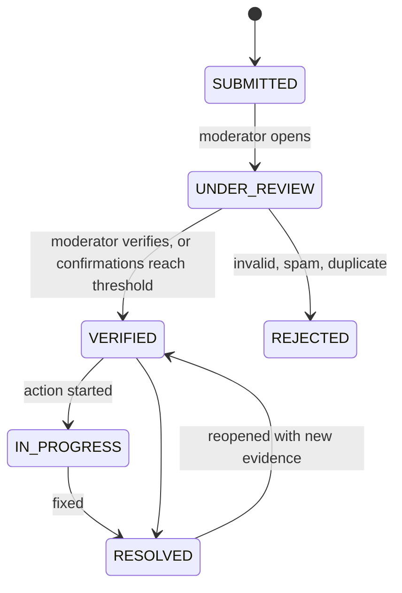
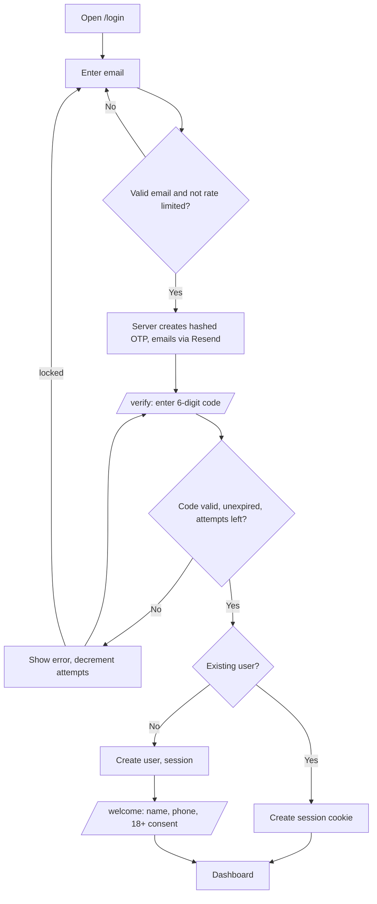
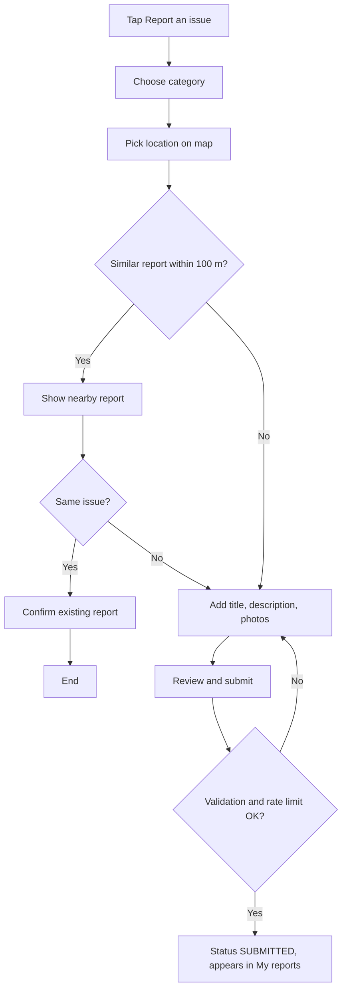
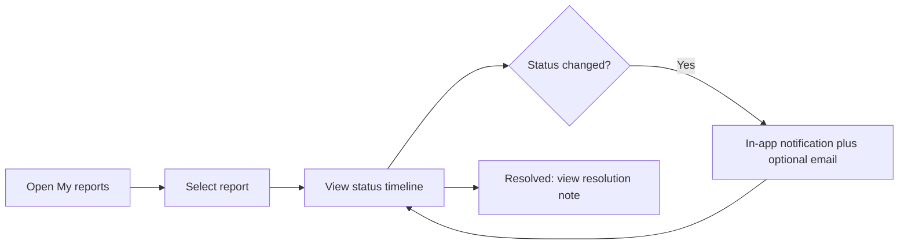
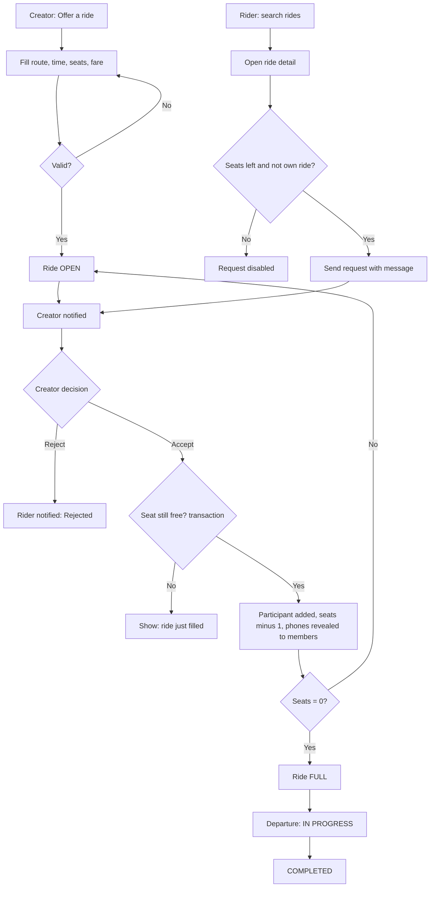
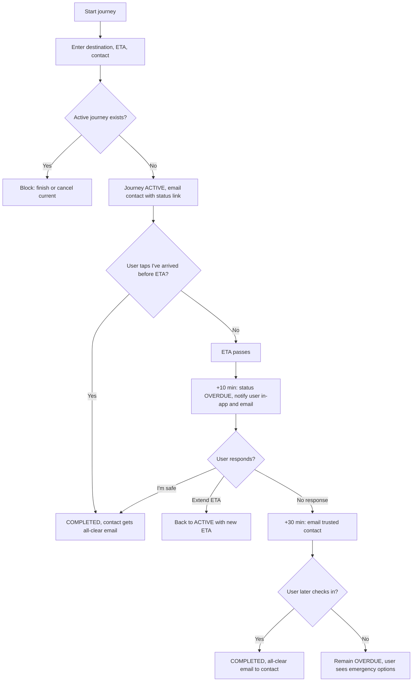
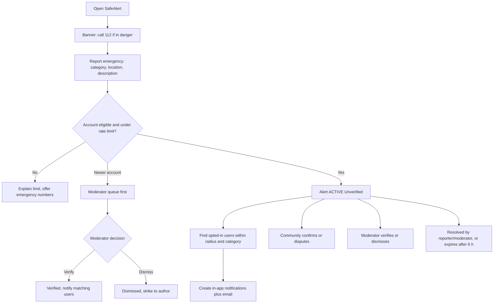
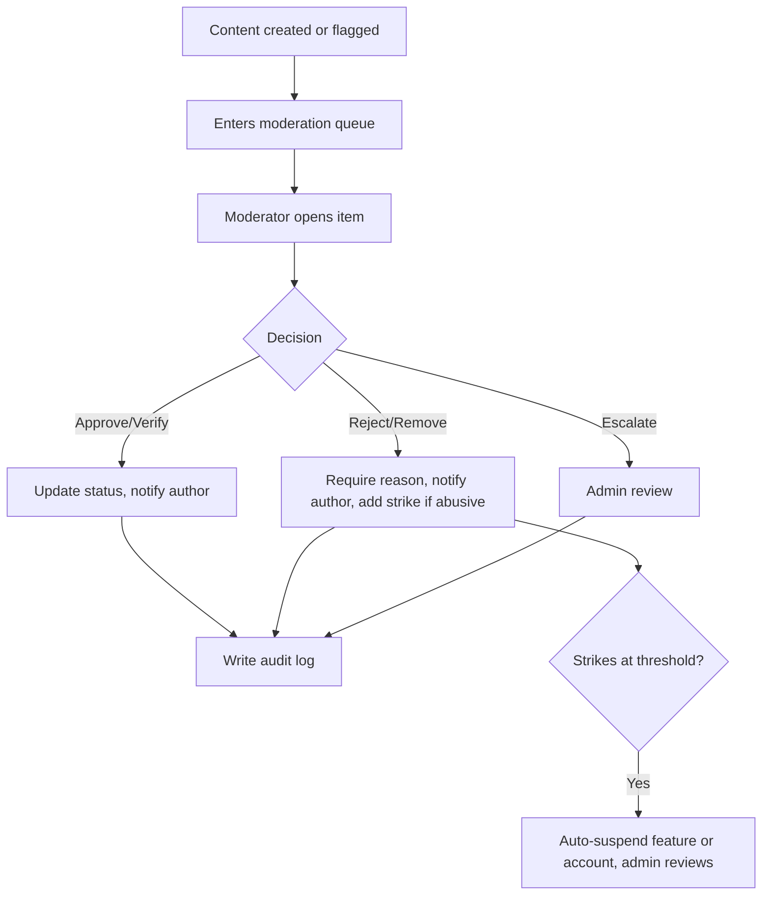
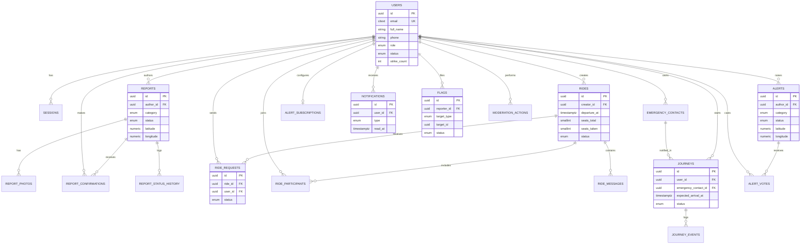

# SAFERSTREETS: COMPLETE PRODUCT, UI/UX & TECHNICAL BLUEPRINT

*Tagline: Safer Streets. Smarter Journeys. Stronger Communities.*

**Conventions used throughout**
- **[MVP]** is essential for the first working release.
- **[OPT]** is optional and added if time allows after the MVP.
- **[FUTURE]** is out of scope for now and only designed for.
- Nothing in this document is claimed as implemented.
- Sections avoid repeating each other: global UI states are defined once in Section 4, and global security rules once in Section 9.

---

## SECTION 1: PRODUCT DEFINITION

### 1.1 Overview
SaferStreets is a web platform (responsive, installable as a PWA later) that combines four modules into one product:

| Module | One-line purpose |
|---|---|
| **SafeRoute** | Report and track unsafe places and broken infrastructure |
| **AutoMate** | Share auto-rickshaw rides to cut cost and travel together |
| **JourneyGuard** | Tell a trusted contact where you're going and when you'll arrive |
| **SafeAlert** | Report emergencies and inform opted-in nearby community members |

### 1.2 Problem Statement
- Unsafe streets (dark roads, potholes, isolated stretches) are known locally but reported nowhere useful, so authorities and neighbours lack a shared, verified picture.
- Daily commuters, especially students, overpay for solo auto rides on routes where others travel the same way.
- People travelling alone, often at night, have no lightweight way to leave a record of their journey with someone they trust.
- Emergencies witnessed by one person rarely reach the people nearby who could help.

### 1.3 Proposed Solution
One account, one dashboard, four connected modules. Community reports feed awareness (SafeRoute), shared rides cut cost and improve safety in numbers (AutoMate), journeys carry a safety net (JourneyGuard), and emergencies reach the nearby community quickly (SafeAlert). A moderation layer keeps content trustworthy.

### 1.4 Target Audience
- **Primary:** college students and campus communities, especially those commuting by auto in tier-2 cities.
- **Secondary:** young professionals, daily commuters, women travelling alone, and residents' associations.
- **Operational users:** moderators (student volunteers or campus admin) and administrators (team or institution).

### 1.5 Objectives
1. Let any user file a geotagged, photo-backed safety report in under 60 seconds.
2. Make shared auto rides discoverable and joinable in under 5 taps.
3. Let a user start a journey with a trusted contact in under 30 seconds.
4. Let a user raise a community alert in under 45 seconds.
5. Keep all content moderated, with abuse controls.
6. Deliver a working, demonstrable MVP deployable by a small college team.

### 1.6 Unique Selling Points
- Four safety and mobility modules in a single cohesive product (not four separate apps).
- Community verification plus moderator review, so reports carry a trust level.
- Built for local transport reality (autos, cash/UPI split, campus routes).
- Privacy-first design: exact contact details are shared only after explicit consent or acceptance.
- Honest scope: it never promises police integration or live tracking it does not have.

### 1.7 Social Impact
Visible, verified safety data helps civic bodies prioritise fixes. Cost-sharing makes safer transport more affordable. Trusted-contact journeys and nearby alerts create a culture of looking out for each other.

### 1.8 Limitations and Assumptions
**Limitations (stated to users in-app)**
- SaferStreets is **not** an emergency service. It does not replace calling 112 / police / ambulance.
- No live GPS tracking, no automatic police or authority escalation, and no guaranteed delivery of alerts.
- Report resolution depends on moderators or authorities; the platform records status but cannot force fixes.
- Notifications are in-app plus email in the MVP; push notifications are [FUTURE].

**Assumptions**
- A1: Launch region is India (campus-first); emergency numbers default to Indian ones and are configurable. Verify numbers before launch (112 national emergency; 100 police; 101 fire; 108 ambulance; 1091 women helpline).
- A2: Email OTP is the only login method (no passwords, no phone OTP). Phone numbers are optional profile data, not verified in the MVP.
- A3: Payments are out of scope. Fares are estimates, and money is settled in person (cash/UPI) between riders.
- A4: Initial moderators are appointed manually by the admin.
- A5: There is no GPS tracking. Location comes from the user dropping a map pin or searching an address, or from a one-time "use my current location" browser prompt when they consent.
- A6: The web app is mobile-first, and no native app is built.
- A7: Users are 18+ (age gate on registration, since rides and emergency features involve adult safety).
- A8: Team size is 3–5 students with roughly 10–12 weeks.

**Missing requirements identified (with decisions)**
| Gap | Decision |
|---|---|
| Who counts as a "trusted contact" without an account? | Token-link contact: no account needed, email-based [MVP] |
| How are alerts abused? | Account-age gate, rate limits, strikes, moderator queue (Section 9) |
| What if a ride creator never responds? | Requests auto-expire 2 h before departure [MVP] |
| Duplicate reports of the same pothole? | "Me too / Confirm" button plus nearby-duplicate warning on submit [MVP] |
| Data retention? | Defined in Section 6.5 |
| Content language? | English only in the MVP; i18n-ready strings [FUTURE: Hindi] |
| Legal pages | Terms, Privacy Policy and Safety Disclaimer pages required before launch |

---

## SECTION 2: COMPLETE FEATURE BREAKDOWN

### 2A. SAFEROUTE: Community Safety Reporting

**Purpose:** Crowdsource unsafe locations and infrastructure problems and track them to resolution.

**Features**
| Feature | Tag |
|---|---|
| Submit report (category, location pin, description, 1–4 photos) | MVP |
| Categories: Broken streetlight, Poor lighting, Pothole, Damaged road, Damaged footpath, Isolated/unsafe area, Other | MVP |
| Browse list and map view of reports with filters (category, status, distance, date) | MVP |
| Report detail page with status timeline | MVP |
| Community verification ("I confirm this" once per user per report) | MVP |
| Moderator status changes with note | MVP |
| Duplicate-nearby warning on submit | MVP |
| My reports page | MVP |
| Flag inappropriate report | MVP |
| Anonymous display (author hidden from public, visible to moderators) | OPT |
| Comments on reports | OPT |
| Severity rating, heatmap view | FUTURE |
| Export or share to municipal authority | FUTURE |

**User actions:** create, edit (while Submitted only), delete own (while Submitted only), confirm others' reports, flag, filter, search, view map.

**User journey:** Open SafeRoute → tap "Report an issue" → pick category → drop pin or search address → add description and photos → review → submit → see it in "My reports" as *Submitted* → receive notifications as status changes → see *Resolved*.

**Fields**
| Field | Type | Rule |
|---|---|---|
| category | enum | required |
| title | text | 5–80 chars, required |
| description | text | 10–1000 chars, required |
| latitude, longitude | decimal | required, valid range, within service region (configurable bounding box) |
| address_text | text | auto-filled from reverse geocode, editable, max 200 |
| photos | image files | 0–4, JPEG/PNG/WebP, ≤5 MB each (compressed client-side to ≤1600 px) |

**Status management**


- Only moderators and admins change status. A mandatory note is required for REJECTED.
- The community-confirmation threshold (default 3 distinct users) moves SUBMITTED to a "Community-confirmed" badge and nudges review priority. It does not auto-verify.
- Every change is logged in `report_status_history`.

**Validation:** as the table above, plus max 5 reports per user per day (see rate limits), and the pin must fall inside the service region.

**Error and empty states:** no reports in the area ("Be the first to report an issue nearby"); photo too large or wrong type; map failed to load (fall back to list view); location permission denied (manual search); offline (retain draft in local storage).

**Permissions and security:** guests can view public reports (photos visible, author hidden); registered users create, confirm and flag; moderators change status. Photos are re-encoded server-side with EXIF stripped (location metadata removed); exact author identity is never shown publicly.

**Dependencies:** Notifications (status changes), Admin/Moderation (queue), Auth, and Dashboard (counts). The same location picker and map component is reused by AutoMate, JourneyGuard and SafeAlert.

---

### 2B. AUTOMATE: Shared Transportation

**Purpose:** Let people travelling the same way split an auto fare.

**Features**
| Feature | Tag |
|---|---|
| Create ride (source, destination, date/time, seats, estimated total fare, note) | MVP |
| Browse and search rides (origin, destination, date, seats) | MVP |
| Request to join (with optional message) | MVP |
| Creator accepts or rejects requests | MVP |
| Participant list, remaining seats, per-person fare share | MVP |
| Cancel request (participant) / cancel ride (creator) with notifications | MVP |
| Leave ride after acceptance | MVP |
| Manage "Created" and "Joined" rides, ride history | MVP |
| Contact reveal: phone visible between creator and accepted participants only | MVP |
| Ride chat (per-ride, accepted members only, Socket.io) | OPT |
| Women-only ride flag | OPT |
| Rating or reporting co-riders after the ride (reporting is MVP; ratings are OPT) | OPT |
| Route-overlap matching, recurring rides | FUTURE |
| In-app payments | FUTURE |

**User actions:** create, edit (before any request is accepted), cancel, search, request, withdraw, accept, reject, leave, start ride, complete ride, report user.

**User journey (creator):** Create ride → ride is *Open* → receives request notifications → accepts → seats decrease → *Full* when seats = 0 → on departure marks *In Progress* → after the ride marks *Completed*.
**User journey (rider):** Search → open ride detail → "Request to join" → await decision → *Accepted* → see creator's phone and co-riders → ride → ride completes.

**Fields**
| Field | Rule |
|---|---|
| source, destination | text plus lat/lng via the location picker; must differ by more than 300 m |
| departure_at | must be at least 15 min in the future and at most 14 days ahead |
| seats_total | integer 1–3 (passenger seats excluding creator; auto-rickshaws typically carry 3) |
| estimated_total_fare | integer ₹10–₹5000 |
| note | optional, ≤300 chars |
| women_only | boolean [OPT] |

**Per-person share** is displayed as `estimated_total_fare ÷ (accepted_participants + 1)` and updates live. It is labelled "estimate".

**Ride statuses:** Open, Full, In Progress, Completed, Cancelled.
- OPEN ↔ FULL is automatic, driven by seat count.
- OPEN or FULL → IN_PROGRESS manually by the creator, or automatically 15 min after departure_at if at least one participant is accepted.
- IN_PROGRESS → COMPLETED manually, or automatically 3 h after departure_at by a background job.
- Any pre-IN_PROGRESS status → CANCELLED by the creator, who must provide a reason; riders are notified.

**Request statuses:** Pending, Accepted, Rejected, Cancelled (by rider), Expired.

**Validation and business rules:**
- A user cannot request their own ride.
- One active request per user per ride (unique constraint).
- A user cannot join two rides departing within 1 hour of each other (prevents spam and double booking).
- Accepting a request must be atomic and fail if seats = 0 (database transaction with row lock).
- Max 3 open rides created per user at a time.
- Requests auto-expire when the ride starts or is cancelled.

**Error and empty states:** no rides match ("Create one, others will find it"); ride full (disable request button, show "Full"); request already pending; ride cancelled while viewing; accept fails due to a concurrent seat-taking (show friendly message and refresh).

**Permissions and security:** guests can browse limited ride cards (no names or phones) but must log in to request. Phone numbers are shown only to the creator and accepted participants. Participant identities are shown to the creator and accepted participants only. Ride safety tips are shown on the request screen.

**Dependencies:** Auth and profiles (name, photo, phone), Notifications (requests and decisions), Moderation (user reports), JourneyGuard (one-tap "Start journey for this ride" prefill).

---

### 2C. JOURNEYGUARD: Personal Journey Safety

**Purpose:** Give users a lightweight record and reminder system so a trusted person knows about a journey.

**Honest scope:** JourneyGuard stores trip details and notifies by email and in-app. It does **not** track live location, contact police, or guarantee escalation.

**Features**
| Feature | Tag |
|---|---|
| Start journey (destination, expected arrival, optional start point, notes, emergency contact) | MVP |
| Manage saved emergency contacts (up to 5) | MVP |
| Email the trusted contact when a journey starts, with a read-only status link | MVP |
| Active journey screen with countdown and "I've arrived safely" button | MVP |
| Extend ETA (up to 2 times, 30 min max each) | MVP |
| Overdue detection (background job) plus in-app and email reminder to user | MVP |
| Overdue email to trusted contact after the escalation window | MVP |
| Emergency button: opens phone dialer (`tel:`) for 112 and the saved contact | MVP |
| Journey history | MVP |
| Prefill from an AutoMate ride | OPT |
| Trusted-contact "I've reached out / acknowledge" button on the status link | OPT |
| Periodic check-in prompts | OPT |
| Live location sharing, SMS, WhatsApp, police integration | FUTURE |

**Overdue logic (decision):**

| Time | Event |
|---|---|
| ETA | Nothing visible, journey still ACTIVE |
| ETA + 10 min | Status → OVERDUE; in-app notification plus email to user: "Have you arrived?" |
| ETA + 30 min (default, user-configurable 20–60) | If still OVERDUE, email to trusted contact with journey details; mark `contact_notified_at` |
| Any time | User taps "I'm safe" → COMPLETED, and contact gets an all-clear email if they'd been alerted |

**Fields**
| Field | Rule |
|---|---|
| destination | required, text plus optional pin |
| start_point | optional |
| expected_arrival_at | required, between 5 min and 24 h in the future |
| emergency_contact_id | required, from saved contacts or created inline |
| notes | optional, ≤300 chars (e.g. vehicle number) |

**Emergency contact fields:** name (required), relationship (optional), email (required in MVP, since it is the only delivery channel), phone (optional, used for the call button), consent confirmation checkbox ("I have informed this person").

**Statuses:** Active, Overdue, Completed, Cancelled.

**Validation:** only 1 active journey at a time per user (simplicity). Contact email must be valid and not the user's own email. Max 3 journeys started per hour.

**Error and empty states:** no saved contacts (prompt to add one first); email delivery failure (show warning "We couldn't email Sam, call them directly"); no history yet; user's network is offline (explain that reminders are server-sent, so the journey is still tracked).

**Permissions and security:** journeys are visible only to the owner. The trusted contact page `/track/[token]` is read-only, shows only destination, ETA and status, and uses a 32-byte random token that expires 24 h after ETA. It shows no profile, phone or history. The contact can opt out ("Stop receiving emails from SaferStreets") via a link.

**Dependencies:** Notifications and email service, background scheduler, Auth, and the Profile emergency contact manager.

---

### 2D. SAFEALERT: Community Emergency Alerts

**Purpose:** Let users flag urgent incidents so opted-in nearby community members are informed.

**Honest scope:** SafeAlert is an informational community feature. It is **not** a dispatch system. Every alert screen shows the emergency call buttons prominently ("If someone is in danger, call 112 first").

**Features**
| Feature | Tag |
|---|---|
| Submit alert (category, location, description, optional photo) | MVP |
| Categories: Road accident, Medical emergency, Harassment, Fire, Public hazard, Other | MVP |
| Alert list and map (active alerts nearby, recent) | MVP |
| Alert detail with status and timeline | MVP |
| Emergency action bar (call 112, call local police/ambulance numbers) | MVP |
| Opt-in alert preferences: area (centre plus radius 1–10 km) and categories | MVP |
| Notify opted-in users in radius via in-app plus email | MVP |
| Community "Confirm" / "Not accurate" voting | MVP |
| Moderator verification, resolve, dismiss | MVP |
| Reporter can mark own alert as Resolved | MVP |
| Web push notifications (PWA) | FUTURE |
| SMS notifications | FUTURE |
| Auto-expiry of stale alerts | MVP (6 h default) |

**User journey:** Open SafeAlert → big "Report emergency" button → (banner: call 112 if in danger) → choose category → location (current location or pin) → short description → optional photo → submit → alert appears as *Active (Unverified)* → opted-in users in radius notified → moderators verify or dismiss → reporter or moderator marks *Resolved* → alert auto-expires.

**Fields**
| Field | Rule |
|---|---|
| category | required enum |
| description | 10–500 chars |
| latitude, longitude, address_text | required |
| photo | optional, 1 image ≤5 MB |
| is_anonymous_to_public | boolean, default true (author shown only to moderators) |

**Statuses:** Active (Unverified), Verified, Resolved, Dismissed, Expired, Removed (moderation).

**Validation and abuse rules:** account must be at least 24 h old with a verified email; max 3 alerts per hour and 10 per day; duplicate suppression (same category within 200 m and 30 min gets a "similar alert exists, confirm it instead?" prompt); a user with 3 dismissed alerts is suspended from SafeAlert pending admin review.

**Notification rule (decision):** an alert from an eligible account notifies matching opted-in users immediately, labelled "Unverified". Alerts from newer or flagged accounts wait in the moderator queue first. The notification text always includes the disclaimer and the 112 button.

**Error and empty states:** no active alerts nearby ("All quiet around you"); location unavailable; rate limit reached; notification delivery failure (logged, the alert still stays visible in-app).

**Permissions and security:** guests see category and approximate area only (coordinates rounded to ~500 m), with no description details or photos. Registered users see exact location and details. Opted-in users' locations are not stored as live positions, only a saved area centre they chose.

**Dependencies:** Notification service, Moderation, Auth, Location picker, and Preferences (opt-in).

---

## SECTION 3: USER ROLES AND PERMISSIONS

**Role types**
- **System roles** (stored in `users.role`): USER, MODERATOR, ADMIN.
- **Contextual roles** (derived from relationships): ride creator, ride participant, trusted contact.
- **Guest** is unauthenticated.

| Role | Definition |
|---|---|
| Guest | Not logged in |
| Registered user | Verified email, profile complete |
| Ride creator | The user who created a specific ride |
| Ride participant | A user whose request to a specific ride was accepted |
| Trusted contact | A person named in a journey. They may have no account and access only via a tokenized link |
| Moderator | Reviews and acts on content |
| Administrator | Full control, including managing moderators |

**Permissions matrix** (✔ allowed, ✖ not allowed, ◐ limited as noted)

| Capability | Guest | User | Ride creator | Ride participant | Trusted contact | Moderator | Admin |
|---|---|---|---|---|---|---|---|
| View landing and legal pages | ✔ | ✔ | ✔ | ✔ | ✔ | ✔ | ✔ |
| Register/login | ✔ | n/a | n/a | n/a | ✖ | n/a | n/a |
| View public SafeRoute reports | ✔ | ✔ | ✔ | ✔ | ✖ | ✔ | ✔ |
| Create/confirm/flag reports | ✖ | ✔ | ✔ | ✔ | ✖ | ✔ | ✔ |
| Edit/delete own report (Submitted only) | ✖ | ✔ | ✔ | ✔ | ✖ | ✔ | ✔ |
| Change report status | ✖ | ✖ | ✖ | ✖ | ✖ | ✔ | ✔ |
| Browse rides (limited cards) | ◐ | ✔ | ✔ | ✔ | ✖ | ✔ | ✔ |
| Create ride | ✖ | ✔ | n/a | ✔ | ✖ | ✔ | ✔ |
| Request to join ride | ✖ | ✔ | ✖ own ride | n/a | ✖ | ✔ | ✔ |
| Accept/reject requests | ✖ | ✖ | ✔ (own ride) | ✖ | ✖ | ✖ | ◐ override |
| See co-rider phone numbers | ✖ | ✖ | ✔ | ✔ (same ride) | ✖ | ◐ moderation case | ◐ |
| Cancel/complete ride | ✖ | ✖ | ✔ | ✖ | ✖ | ✔ | ✔ |
| Start/complete own journey | ✖ | ✔ | ✔ | ✔ | ✖ | ✔ | ✔ |
| View a journey via token link | ✖ | ✖ | ✖ | ✖ | ✔ (that journey only) | ✖ | ✖ |
| Submit alert | ✖ | ✔ (eligible) | ✔ | ✔ | ✖ | ✔ | ✔ |
| View alerts | ◐ approx | ✔ | ✔ | ✔ | ✖ | ✔ | ✔ |
| Verify/dismiss alerts | ✖ | ✖ | ✖ | ✖ | ✖ | ✔ | ✔ |
| Confirm alert accuracy | ✖ | ✔ | ✔ | ✔ | ✖ | ✔ | ✔ |
| Flag any content/user | ✖ | ✔ | ✔ | ✔ | ✖ | ✔ | ✔ |
| Access moderation queue | ✖ | ✖ | ✖ | ✖ | ✖ | ✔ | ✔ |
| Suspend/ban users | ✖ | ✖ | ✖ | ✖ | ✖ | ◐ temp suspend | ✔ |
| Manage roles, system settings, audit log | ✖ | ✖ | ✖ | ✖ | ✖ | ✖ | ✔ |

---

## SECTION 4: COMPLETE UI/UX BLUEPRINT

### 4.1 Design Direction
A calm, trustworthy, **urban-night** aesthetic: map-forward, large touch targets, clear status colours, and soft, rounded surfaces. It feels like a polished consumer safety app, not an admin panel. Each module has an identity colour used for icons, chips and accents.

**Colour palette (light theme; dark theme mirrors with tokens)**
| Token | Hex | Use |
|---|---|---|
| `--brand` Deep Indigo | #2F2A6B | Primary buttons, nav active |
| `--brand-accent` Signal Teal | #14B8A6 | Highlights, success-leaning actions |
| SafeRoute | Amber #F59E0B | Module accent |
| AutoMate | Sky #0EA5E9 | Module accent |
| JourneyGuard | Violet #7C3AED | Module accent |
| SafeAlert | Crimson #DC2626 | Module accent and emergency actions only |
| Success / Warning / Danger / Info | #16A34A / #D97706 / #DC2626 / #2563EB | Status |
| Neutrals | #0F172A, #334155, #64748B, #E2E8F0, #F8FAFC | Text and surfaces |

Rules: red is reserved for emergencies and destructive actions (it must not be used decoratively). Status is never conveyed by colour alone (always icon plus label).

**Typography:** Plus Jakarta Sans (headings) and Inter (body), via `next/font`. Scale: 12 / 14 / 16 (body) / 18 / 20 / 24 / 30 / 36. Line height 1.5 body, 1.2 headings. Minimum body size 16 px on mobile.

**Spacing and shape:** 4 px grid, 12–16 px card radius, 8 px control radius, soft shadows, 44×44 px minimum touch targets.

**Accessibility (target WCAG 2.2 AA):** contrast ≥ 4.5:1 for text; visible focus rings; full keyboard navigation; semantic HTML and ARIA only where needed; form labels and inline errors linked via `aria-describedby`; alt text required for uploaded photos (auto "Photo of [category]" fallback); `prefers-reduced-motion` respected; map has a list alternative; status chips carry text; the SOS area is operable with one hand.

### 4.2 Navigation Structure
- **Desktop (≥1024 px):** left collapsible sidebar (Dashboard, SafeRoute, AutoMate, JourneyGuard, SafeAlert, Notifications) plus top bar (search, notification bell with badge, profile menu). A persistent red **"Emergency"** chip in the top bar opens the emergency-numbers sheet.
- **Tablet:** icon-only collapsed sidebar.
- **Mobile (<768 px):** bottom tab bar with 5 items: **Home · Routes · Rides · Journey · Alerts**. The top bar holds the bell and avatar (profile, settings). The Emergency sheet is reachable from the top bar and from every alert and journey screen.
- **Admin:** a separate layout with its own sidebar (Overview, Moderation, Users, Flags, Audit log, Settings), shown only to moderators and admins.
- Breadcrumbs are used on detail pages on desktop; a back arrow is used on mobile.

### 4.3 Reusable Components
`AppShell`, `SidebarNav`, `BottomTabBar`, `TopBar`, `Button` (primary / secondary / ghost / danger / emergency), `IconButton`, `TextField`, `TextArea`, `Select`, `DateTimePicker`, `OTPInput` (6 boxes, auto-advance, paste support), `ImageUploader` (preview, remove, progress), `LocationPicker` (map plus address search plus "use my location"), `MapView` (cluster markers), `Card`, `ReportCard`, `RideCard`, `AlertCard`, `JourneyCard`, `StatusChip`, `CategoryIcon`, `Timeline`, `Tabs`, `FilterBar`, `Modal` / `BottomSheet`, `ConfirmDialog`, `Toast`, `Banner` (disclaimer, offline), `Skeleton`, `EmptyState`, `ErrorState`, `Avatar`, `Badge`, `NotificationItem`, `Pagination` / `InfiniteList`, `EmergencySheet`, `DataTable` (admin), `Stepper`, `CountdownTimer`.

### 4.4 Global State Patterns (defined once; each screen lists only specifics)
- **Loading:** skeleton shapes matching the final layout (never a lone spinner for page content); buttons show an inline spinner and are disabled during submit.
- **Empty:** icon, one-line explanation, and one primary action.
- **Error (page):** friendly message, "Try again" button, and a "Report a problem" link; the error code is shown in small text.
- **Error (field):** inline red text below the field with an icon, plus a form-level summary on submit.
- **Success:** toast ("Report submitted") plus navigation to the created item; destructive or major actions use a confirm dialog first.
- **Offline:** top banner "You're offline. Changes will not be saved"; drafts persist locally.
- **Unauthorized:** redirect to login with `?next=` return path; 403 page for role denials.

### 4.5 Screen-by-Screen Specification

Notation: **Layout** · **Components** · **Buttons → action** · **Forms** · **Nav** · **States (beyond global)**.

#### Public and Auth

**S1. Landing page `/`**
- *Purpose:* explain the product and drive sign-up.
- *Layout:* hero (headline, tagline, CTA, phone mockup) → four module cards → "How it works" 3 steps → trust and safety note (clear limitations) → FAQ → footer.
- *Components:* top bar, `Card`, accordion, footer with legal links.
- *Buttons:* "Get started" → `/login`; "Log in" → `/login`; module cards → sign-up prompt or public preview; "Call 112" static helper in the footer.
- *Nav:* anchor links plus Login.
- *States:* static; skeleton not needed.

**S2. Login / Register `/login`** (one screen; the email OTP flow covers both)
- *Purpose:* single entry for new and returning users.
- *Layout:* centred card with logo, heading, and email field.
- *Forms:* email (required, valid format); 18+ and Terms checkbox (shown for new emails after the OTP step in S4 instead, to keep the entry simple).
- *Buttons:* "Send code" → `POST /auth/otp/request`; "Terms" / "Privacy" links.
- *States:* invalid email; rate-limited ("Too many attempts, try again in N min"); neutral success message is always the same wording, so account existence isn't revealed.

**S3. OTP verification `/verify`**
- *Purpose:* confirm email ownership.
- *Layout:* card with "Code sent to a***@x.com", 6-box OTP input, resend timer.
- *Buttons:* "Verify" (auto-submits on the 6th digit) → `POST /auth/otp/verify`; "Resend code" (enabled after 60 s) → request again; "Change email" → S2.
- *States:* wrong code (shake plus "n attempts left"); expired code; locked ("Request a new code"); success → dashboard (existing users) or S4 (new users).

**S4. Onboarding/Profile setup `/welcome`**
- *Purpose:* complete the minimum profile.
- *Forms:* full name (required, 2–60), phone (optional, 10-digit Indian format), profile photo (optional), checkbox "I am 18+ and agree to Terms and Privacy" (required), optional opt-in toggles (alert notifications) with a short explanation.
- *Buttons:* "Continue" → `PATCH /me`; "Skip photo".
- *States:* upload errors; name missing.

#### Dashboard

**S5. Dashboard `/dashboard`**
- *Purpose:* single place for status and quick actions.
- *Layout:* greeting; **Quick actions** row (Report issue, Offer a ride, Start journey, Raise alert); **Active journey** banner (if any, with countdown); **Nearby alerts** strip; **Upcoming rides** card; **My recent reports** card; **Community snapshot** (counts in the user's area).
- *Components:* `JourneyCard`, `AlertCard`, `RideCard`, `ReportCard`, `EmptyState` per card.
- *Buttons:* each quick action → its create flow; "View all" links; Active journey → "I've arrived" shortcut.
- *States:* each card loads independently (skeletons) and fails independently; a new-user checklist ("Add emergency contact", "Set alert area") is shown until complete.

#### SafeRoute

**S6. Report list/map `/saferoute`**
- *Layout:* top filter bar (category chips, status select, "Near me" radius, date range); view toggle List/Map; split view on desktop (list left, map right); full-screen map with a bottom-sheet list on mobile.
- *Components:* `FilterBar`, `ReportCard`, `MapView`, `StatusChip`.
- *Buttons:* "Report an issue" (floating on mobile) → S7; card → S8; "Clear filters".
- *States:* empty (no reports match, with a clear-filters prompt); map load error → list-only fallback.

**S7. New report `/saferoute/new`** (stepper: Category → Location → Details → Review)
- *Forms:* as in 2A. Step 2 shows nearby existing reports ("Is this the same issue?" with a Confirm option).
- *Buttons:* Next / Back; "Submit report" → `POST /reports`; "Save draft" (local).
- *States:* upload progress per photo; out-of-region pin error; success → S8 with a toast.

**S8. Report detail `/saferoute/[id]`**
- *Layout:* photo carousel; title and category; status chip and timeline (history); description; mini-map; confirmation count and "Confirm this issue" button; "Flag" menu; moderator note.
- *Buttons:* Confirm → `POST /reports/:id/confirm`; Flag → modal with reason; Edit/Delete (owner, Submitted only); moderators see a Status dropdown plus note (inline panel).
- *States:* not found/removed; already confirmed (button toggles to "Confirmed ✓" with an undo).

**S9. My reports `/saferoute/mine`:** tabbed by status; `ReportCard` list; actions Edit/Delete where allowed; empty: "You haven't reported anything yet".

#### AutoMate

**S10. Browse rides `/automate`**
- *Layout:* search card (From, To, Date, Seats) with swap button; results list sorted by departure; filters (time window, price, women-only [OPT]).
- *Components:* `RideCard` (route, time, seats left, per-person share, creator avatar and first name).
- *Buttons:* "Offer a ride" → S11; card → S12.
- *States:* empty with "Create this ride" prefilled from search; guests see a "Log in to request" prompt.

**S11. Create ride `/automate/new`**
- *Forms:* as in 2B, with two `LocationPicker`s, `DateTimePicker`, seat stepper, fare input with live "≈ ₹X each" preview.
- *Buttons:* "Publish ride" → `POST /rides`; cancel.
- *States:* time-in-past error; same source and destination error; max open rides reached.

**S12. Ride detail `/automate/[id]`**
- *Layout:* route map; time; creator card; seats and per-person fare; participants list (visible to members only); requests panel (creator only); safety tips box; chat link [OPT].
- *Buttons (by role):* Visitor → "Request to join" (opens message modal) → `POST /rides/:id/requests`; Requester → "Withdraw request"; Creator → "Accept"/"Reject" per request, "Cancel ride", "Mark in progress", "Mark completed"; Participant → "Leave ride", "Report user".
- *States:* Full, Cancelled, Completed banners; pending-request state; concurrent-accept error.

**S13. My rides `/automate/mine`:** tabs **Created / Joined / Requests pending / History**; `RideCard` list; each card has relevant quick actions.

**S14. Ride chat `/automate/[id]/chat` [OPT]:** message list, input, member header; system messages for joins and leaves; disabled after the ride completes plus 24 h.

#### JourneyGuard

**S15. JourneyGuard home `/journeyguard`**
- *Layout:* if a journey is active → large **Active Journey** card (destination, countdown, ETA, contact name, "I've arrived safely", "Extend", "Emergency"); else → "Start a journey" card plus the last 3 journeys and the contacts shortcut.
- *States:* no contact yet → onboarding prompt.

**S16. Start journey `/journeyguard/new`**
- *Forms:* as in 2C. Contact selector (saved list or "Add new"), ETA picker with quick chips (+15, +30, +60 min), a preview of exactly what the contact will receive.
- *Buttons:* "Start journey" → `POST /journeys`; cancel.
- *States:* an active journey already exists (link to it); contact email delivery failure warning on success.

**S17. Active journey detail `/journeyguard/[id]`:** status chip; timeline (started, extended, reminder sent, contact notified); buttons "I've arrived safely" → `POST /journeys/:id/complete`; "Extend ETA" (modal, 15 / 30 min); "Cancel journey"; **Emergency** section (Call 112, Call [contact name]). OVERDUE state turns the header amber with a prominent "Are you safe?" prompt.

**S18. Journey history `/journeyguard/history`:** filterable list (Completed / Cancelled / Overdue-resolved); detail view read-only; empty state.

**S19. Emergency contacts `/journeyguard/contacts` (also inside Settings):** list with edit/delete; add form; consent checkbox; "Send test email" button [OPT].

**S20. Trusted-contact status page `/track/[token]` (public, no login)**
- *Layout:* minimal branded page: "[First name] started a journey", destination, expected arrival, current status (Active / Overdue / Arrived), last-updated time, plain-language disclaimer ("This page does not show live location"), "Stop emails" link.
- *States:* expired or invalid token (neutral message); arrived (green); overdue (amber, with call suggestions).

#### SafeAlert

**S21. Alerts feed `/safealert`**
- *Layout:* sticky red banner "In danger? Call 112" plus **Report emergency** button; Nearby / All tabs; map plus list; filter by category and status.
- *Components:* `AlertCard` (category icon, time ago, distance, status chip, confirmation count).
- *States:* empty ("All quiet nearby"); guest view with approximate locations and a "Log in for details" prompt.

**S22. New alert `/safealert/new`**
- *Layout:* single page; top banner "Call 112 first if anyone is in immediate danger"; large category tiles; location (use current location or pin); description; optional photo; anonymity toggle; "Submit alert".
- *Buttons:* Submit → `POST /alerts`; "Call 112" (always visible).
- *States:* rate-limit or account-age gating message with an explanation; duplicate suggestion modal; submission success shows what happens next ("Moderators will review. Nearby opted-in users have been notified").

**S23. Alert detail `/safealert/[id]`:** header (category, status); description; map; timeline; Confirm / "Not accurate" buttons; **Emergency actions** bar (Call 112, Police, Ambulance, Women helpline as relevant to category); reporter or moderator "Mark resolved"; Flag.

**S24. Alert preferences (Settings tab):** toggle "Receive community alerts", area picker (map circle plus radius slider), category checkboxes, delivery (in-app always; email toggle).

#### Notifications, Profile, Settings

**S25. Notification centre `/notifications`:** grouped by Today / Earlier; filters All / Unread / by module; item shows icon, text, time, deep link; "Mark all read". Empty: "You're all caught up".

**S26. Profile `/profile`:** avatar, name, member since, verified-email badge, stats (reports, rides), phone (visible only to me). Edit mode: name, phone, photo upload and crop. Actions: "Save" → `PATCH /me`.

**S27. Settings `/settings`:** tabs **Account** (email shown, delete account) · **Privacy** (who sees phone: ride members only; anonymous-by-default toggle for reports and alerts; data download request) · **Notifications** (per-module email toggles) · **Alert area** (S24) · **Contacts** (S19) · **Sessions** (active devices, "Log out everywhere").

#### Admin / Moderation

**S28. Admin overview `/admin`:** counters (pending reports, pending alerts, open flags, active users), recent actions, charts (reports by category; alerts by day).

**S29. Moderation queue `/admin/moderation`:** tabs Reports / Alerts / Rides / Users; `DataTable` with sort, filters, bulk select; row opens a side panel with full content, author (moderator-visible), history, and actions (Verify, Reject with required reason, Resolve, Remove, Warn user).

**S30. Flags `/admin/flags`:** list of user-submitted flags grouped by target; resolve or dismiss with note.

**S31. User management `/admin/users` (admin; moderators see read-only plus temp suspend):** search; user detail (status, strikes, content counts); actions Suspend (with duration and reason), Ban, Promote/Demote role (admin only).

**S32. Audit log `/admin/audit` (admin):** immutable list of moderation and role actions with actor, target, time and reason; export CSV.

**S33. System settings `/admin/settings` (admin):** service-region bounding box, emergency numbers, thresholds (confirmations, overdue window, rate limits).

**System pages:** 404, 403, 500, maintenance, and Terms / Privacy / Safety Disclaimer / About.

---

## SECTION 5: USER FLOWS

### 5.1 Registration and Login


### 5.2 Submitting a SafeRoute Report


### 5.3 Viewing and Tracking a Report


### 5.4 Creating a Shared Ride and 5.5 Requesting/Accepting


### 5.6 Starting and Completing a Journey; 5.7 Overdue Handling

Nothing beyond email and in-app notification happens automatically (stated in the UI).

### 5.8 Creating and Viewing an Emergency Alert


### 5.9 Admin Moderation


---

## SECTION 6: DATABASE DESIGN

**Database:** PostgreSQL. **Conventions:** UUID primary keys (`gen_random_uuid()`), `created_at` / `updated_at` as `timestamptz`, soft delete via `deleted_at` where noted, and enums implemented as Prisma enums.

### 6.1 Enums
| Enum | Values |
|---|---|
| UserRole | USER, MODERATOR, ADMIN |
| UserStatus | ACTIVE, SUSPENDED, BANNED, DELETED |
| ReportCategory | BROKEN_STREETLIGHT, POOR_LIGHTING, POTHOLE, DAMAGED_ROAD, DAMAGED_FOOTPATH, ISOLATED_AREA, OTHER |
| ReportStatus | SUBMITTED, UNDER_REVIEW, VERIFIED, IN_PROGRESS, RESOLVED, REJECTED |
| RideStatus | OPEN, FULL, IN_PROGRESS, COMPLETED, CANCELLED |
| RideRequestStatus | PENDING, ACCEPTED, REJECTED, CANCELLED, EXPIRED |
| JourneyStatus | ACTIVE, OVERDUE, COMPLETED, CANCELLED |
| AlertCategory | ROAD_ACCIDENT, MEDICAL, HARASSMENT, FIRE, PUBLIC_HAZARD, OTHER |
| AlertStatus | ACTIVE, VERIFIED, RESOLVED, DISMISSED, EXPIRED, REMOVED |
| NotificationType | REPORT_STATUS, REPORT_CONFIRMED, RIDE_REQUEST, RIDE_DECISION, RIDE_UPDATE, RIDE_MESSAGE, JOURNEY_REMINDER, JOURNEY_OVERDUE, ALERT_NEARBY, ALERT_UPDATE, MODERATION, SYSTEM |
| FlagTargetType | REPORT, RIDE, ALERT, USER, RIDE_MESSAGE |
| FlagStatus | OPEN, ACTIONED, DISMISSED |

### 6.2 Tables

**users**
| Column | Type | Constraints |
|---|---|---|
| id | uuid | PK |
| email | citext | UNIQUE, NOT NULL |
| email_verified_at | timestamptz | |
| full_name | varchar(60) | NOT NULL after onboarding |
| phone | varchar(15) | nullable, format-checked |
| avatar_url | text | |
| role | UserRole | default USER |
| status | UserStatus | default ACTIVE |
| terms_accepted_at | timestamptz | |
| strike_count | int | default 0, CHECK ≥ 0 |
| alerts_suspended_until | timestamptz | |
| prefs | jsonb | notification and privacy preferences |
| last_login_at, created_at, updated_at, deleted_at | timestamptz | |

**otp_codes**: `id`, `email`, `code_hash` (HMAC-SHA256 with server secret), `expires_at`, `attempts` (int), `consumed_at`, `ip`, `created_at`. Index `(email, created_at desc)`.

**sessions**: `id`, `user_id` FK, `token_hash` UNIQUE, `user_agent`, `ip`, `expires_at`, `revoked_at`, `created_at`. Index `user_id`.

**emergency_contacts**: `id`, `user_id` FK (cascade), `name`, `relationship`, `email`, `phone`, `consent_confirmed` bool NOT NULL, `unsubscribed_at`, timestamps. UNIQUE `(user_id, email)`; max 5 per user enforced in the service layer.

**reports**: `id`, `author_id` FK, `category`, `title` varchar(80), `description` text, `latitude` numeric(9,6), `longitude` numeric(9,6), `address_text`, `status`, `confirmation_count` int default 0, `moderator_note`, `resolved_at`, timestamps, `deleted_at`. CHECKs on lat/lng ranges. Indexes: `(status, created_at desc)`, `(category)`, `(latitude, longitude)`, `author_id`.

**report_photos**: `id`, `report_id` FK, `url`, `storage_key`, `width`, `height`, `position`. **report_confirmations**: `report_id`, `user_id`, `created_at`, PK `(report_id, user_id)`. **report_status_history**: `id`, `report_id`, `from_status`, `to_status`, `changed_by` FK, `note`, `created_at`.

**rides**: `id`, `creator_id` FK, `source_text`, `source_lat`, `source_lng`, `dest_text`, `dest_lat`, `dest_lng`, `departure_at` timestamptz, `seats_total` smallint CHECK 1–3, `seats_taken` smallint default 0 CHECK `seats_taken <= seats_total`, `estimated_total_fare` int CHECK 10–5000, `note`, `women_only` bool [OPT], `status`, `cancel_reason`, timestamps. Indexes: `(status, departure_at)`, `(source_lat, source_lng)`, `(dest_lat, dest_lng)`, `creator_id`.

**ride_requests**: `id`, `ride_id` FK, `user_id` FK, `message`, `status`, `decided_at`, timestamps. **UNIQUE `(ride_id, user_id)`**; index `(user_id, status)`.

**ride_participants**: `ride_id`, `user_id`, `joined_at`, `left_at`; PK `(ride_id, user_id)`. The creator is not a participant row (the creator is `rides.creator_id`).

**ride_messages [OPT]**: `id`, `ride_id`, `sender_id`, `body` (≤500), `created_at`. Index `(ride_id, created_at)`.

**journeys**: `id`, `user_id` FK, `emergency_contact_id` FK, `destination_text`, `dest_lat`, `dest_lng`, `start_text`, `notes`, `started_at`, `expected_arrival_at`, `extensions_used` smallint default 0, `status`, `overdue_at`, `contact_notified_at`, `completed_at`, `track_token_hash` UNIQUE, `track_token_expires_at`, `escalation_minutes` default 30. Partial UNIQUE index on `(user_id) WHERE status IN ('ACTIVE','OVERDUE')` enforces one active journey. Index `(status, expected_arrival_at)` for the scheduler.

**journey_events**: `id`, `journey_id`, `type` (STARTED, EXTENDED, REMINDER_SENT, CONTACT_NOTIFIED, COMPLETED, CANCELLED), `meta` jsonb, `created_at`.

**alerts**: `id`, `author_id` FK, `category`, `description`, `latitude`, `longitude`, `address_text`, `photo_url`, `status`, `is_anonymous` bool, `confirm_count`, `dispute_count`, `needs_review_first` bool, `verified_by` FK, `resolved_at`, `expires_at`, timestamps. Indexes: `(status, created_at desc)`, `(latitude, longitude)`, `author_id`.

**alert_votes**: `alert_id`, `user_id`, `vote` ('CONFIRM'|'DISPUTE'), PK `(alert_id, user_id)`.

**alert_subscriptions** (opt-in): `user_id` PK/FK, `enabled`, `center_lat`, `center_lng`, `radius_km` CHECK 1–10, `categories` AlertCategory[], `email_enabled`.

**notifications**: `id`, `user_id` FK, `type`, `title`, `body`, `link`, `data` jsonb, `read_at`, `email_sent_at`, `created_at`. Index `(user_id, read_at, created_at desc)`.

**flags**: `id`, `reporter_id` FK, `target_type`, `target_id` uuid, `reason` (enum or text ≤300), `status`, `resolved_by`, `resolution_note`, `created_at`. UNIQUE `(reporter_id, target_type, target_id)`; index `(status, created_at)`.

**moderation_actions** (audit log): `id`, `actor_id` FK, `action` (VERIFY, REJECT, REMOVE, SUSPEND, BAN, ROLE_CHANGE, STRIKE, etc.), `target_type`, `target_id`, `reason`, `meta` jsonb, `created_at`. Append-only (no update/delete in the application).

**system_settings**: `key` PK, `value` jsonb, `updated_by`, `updated_at` (region box, thresholds, emergency numbers).

### 6.3 ER Diagram

*(`flags.target_id` is polymorphic, so it has no database-level FK; integrity is enforced in the service layer.)*

### 6.4 Data Validation
Validation happens at three layers: Zod schemas shared by the web and API (primary), the service layer for business rules, and database CHECK / UNIQUE / FK constraints as the final safety net. Geographic queries use a bounding-box prefilter on lat/lng indexes, then Haversine distance in SQL or in code. PostGIS is [FUTURE], to be adopted if scale demands it.

### 6.5 Retention and Privacy
| Data | Retention |
|---|---|
| OTP codes | Deleted 24 h after expiry |
| Sessions | Deleted 30 days after expiry/revocation |
| Journeys and events | Keep 90 days after completion, then delete (user can delete sooner) |
| Emergency contacts | Until the user deletes them; hard-delete on account deletion |
| Ride messages | 30 days after ride end |
| Alerts | Keep 12 months for moderation analytics, with the author link dropped after 90 days |
| Reports | Retained (public-interest data); author link anonymised on account deletion |
| Notifications | 60 days |
| Audit log | 2 years |
| Account deletion | Soft delete → 30-day grace → PII scrub (email, name, phone, photo); public content retains anonymised authorship |
- Phone numbers are stored only if provided, are never returned by public endpoints, and are never logged.
- Provide a "Download my data" export (JSON) [OPT] and account deletion [MVP].

---

## SECTION 7: BACKEND ARCHITECTURE

### 7.1 Architecture Decision
A **modular monolith**: one Express + TypeScript API (`apps/api`) consumed by the Next.js web app (`apps/web`), in a single monorepo with a shared `packages/shared` (Zod schemas, enums, types). It is one deployable backend, with simple module folders and no microservices.

```
apps/api/src/
  modules/{auth,users,reports,rides,journeys,alerts,notifications,admin,uploads}/
    *.routes.ts  *.controller.ts  *.service.ts  *.schema.ts
  middleware/{auth,rbac,validate,rateLimit,error,upload}.ts
  jobs/{journeyScheduler,rideLifecycle,alertExpiry,otpCleanup}.ts
  lib/{prisma,mailer,storage,geo,logger}.ts
```
Request flow: **route → rate limit → auth → RBAC → Zod validate → controller → service (business rules, Prisma transaction) → response**. Errors flow to a single error handler.

### 7.2 API Conventions
- Base path `/api/v1`, JSON only, session via httpOnly cookie.
- Pagination: `?page=1&limit=20` (max 50) → `{ data, meta:{page,limit,total} }`.
- Error shape:
```json
{ "error": { "code": "VALIDATION_ERROR", "message": "Invalid input", "details": [{"field":"title","message":"Min 5 characters"}] } }
```
- Codes: `VALIDATION_ERROR` 400, `UNAUTHENTICATED` 401, `FORBIDDEN` 403, `NOT_FOUND` 404, `CONFLICT` 409, `RATE_LIMITED` 429, `INTERNAL` 500.
- Dates are ISO 8601 UTC. The UI renders in the user's timezone (IST default).

### 7.3 Authentication Middleware and Authorization
- `requireAuth`: reads the session cookie, hashes the token, loads the session and user, and rejects revoked, expired or BANNED/SUSPENDED users.
- `requireRole('MODERATOR')`, with admin implied.
- Resource-level checks live in services (e.g. `assertRideCreator(rideId, userId)`); they are never left to the client.
- CSRF: SameSite=Lax cookies plus a custom header check (`X-Requested-With`) on state-changing requests, and a strict CORS allow-list.

### 7.4 Endpoints by Module

**Auth**
| Method | Path | Purpose | Auth |
|---|---|---|---|
| POST | /auth/otp/request | Send OTP `{email}` | none |
| POST | /auth/otp/verify | Verify `{email, code}`, set session | none |
| POST | /auth/logout | Revoke the current session | user |
| POST | /auth/logout-all | Revoke all sessions | user |

**Users and profile**
| Method | Path | Purpose |
|---|---|---|
| GET | /me | Current user plus counts |
| PATCH | /me | Update name, phone, prefs, terms acceptance |
| POST | /me/avatar | Upload avatar |
| DELETE | /me | Request account deletion |
| GET/POST/PATCH/DELETE | /me/contacts[/:id] | Emergency contacts CRUD |
| GET/PUT | /me/alert-subscription | Alert opt-in settings |
| GET | /users/:id/public | Public profile (name, avatar, joined date) |

**SafeRoute**
| Method | Path | Purpose |
|---|---|---|
| GET | /reports | List with filters `category,status,lat,lng,radius,from,to,mine` |
| POST | /reports | Create (multipart or pre-uploaded photo keys) |
| GET | /reports/:id | Detail plus history |
| PATCH | /reports/:id | Edit own (Submitted only) |
| DELETE | /reports/:id | Delete own (Submitted only) |
| POST/DELETE | /reports/:id/confirm | Add or remove confirmation |
| GET | /reports/nearby-duplicates | `lat,lng,category` check |
| PATCH | /admin/reports/:id/status | Moderator status change `{status, note}` |

**AutoMate**
| Method | Path | Purpose |
|---|---|---|
| GET | /rides | Search `from,to,date,seats,status` (guests get a limited projection) |
| POST | /rides | Create |
| GET | /rides/:id | Detail (fields vary by viewer role) |
| PATCH | /rides/:id | Edit (before accepted requests) |
| POST | /rides/:id/cancel | Cancel with reason |
| POST | /rides/:id/start, /complete | Lifecycle (creator) |
| POST | /rides/:id/requests | Request to join `{message}` |
| GET | /rides/:id/requests | Creator: list requests |
| POST | /rides/:id/requests/:reqId/accept, /reject | Decision |
| DELETE | /rides/:id/requests/mine | Withdraw |
| POST | /rides/:id/leave | Participant leaves |
| GET | /me/rides?role=created\|joined\|requests | My rides |
| GET/POST | /rides/:id/messages | Chat history, send [OPT] |

**JourneyGuard**
| Method | Path | Purpose |
|---|---|---|
| POST | /journeys | Start |
| GET | /journeys/active | Current journey |
| GET | /journeys | History |
| GET | /journeys/:id | Detail with events |
| POST | /journeys/:id/complete | "I've arrived" |
| POST | /journeys/:id/extend | `{minutes: 15\|30}` |
| POST | /journeys/:id/cancel | Cancel |
| GET | /track/:token | Public, read-only status for the trusted contact |
| POST | /track/:token/unsubscribe | Contact opts out |

**SafeAlert**
| Method | Path | Purpose |
|---|---|---|
| GET | /alerts | List `category,status,lat,lng,radius` (guests get an approximate projection) |
| POST | /alerts | Create (eligibility and rate limit checks) |
| GET | /alerts/:id | Detail |
| POST | /alerts/:id/vote | `{vote:"CONFIRM"\|"DISPUTE"}` |
| POST | /alerts/:id/resolve | Author or moderator |
| PATCH | /admin/alerts/:id/status | Verify / dismiss / remove |

**Notifications**
| Method | Path | Purpose |
|---|---|---|
| GET | /notifications | List `unread=true` |
| GET | /notifications/unread-count | Badge |
| PATCH | /notifications/:id/read | Mark read |
| POST | /notifications/read-all | Mark all read |

**Flags and Admin**
| Method | Path | Purpose |
|---|---|---|
| POST | /flags | `{targetType,targetId,reason}` |
| GET | /admin/overview | Counters |
| GET | /admin/queue | Moderation queue `type,status` |
| GET/PATCH | /admin/flags[/:id] | Review flags |
| GET | /admin/users | Search |
| POST | /admin/users/:id/suspend, /ban, /restore | Actions |
| PATCH | /admin/users/:id/role | Admin only |
| GET | /admin/audit | Audit log |
| GET/PUT | /admin/settings | System settings |

**Uploads**
| Method | Path | Purpose |
|---|---|---|
| POST | /uploads/sign | Returns a signed upload params for images (`purpose: report\|alert\|avatar`) |

### 7.5 Request and Response Examples

**Request OTP**
```http
POST /api/v1/auth/otp/request
{ "email": "arnav@example.com" }
→ 200 { "data": { "message": "If this email is valid, a code has been sent.", "resendAfterSeconds": 60 } }
```

**Create report**
```http
POST /api/v1/reports
{
  "category": "BROKEN_STREETLIGHT",
  "title": "Streetlight out near hostel gate",
  "description": "Three consecutive lights are off, the road is very dark after 7 pm.",
  "latitude": 25.1425, "longitude": 75.8340,
  "addressText": "Main Road, near Gate 2",
  "photos": [{ "storageKey": "reports/abc123.webp" }]
}
→ 201 { "data": { "id": "9f1c…", "status": "SUBMITTED", "confirmationCount": 0, "createdAt": "2026-11-23T07:10:00Z" } }
```

**Accept ride request**
```http
POST /api/v1/rides/7ab2…/requests/c41d…/accept
→ 200 { "data": { "ride": { "id":"7ab2…", "status":"OPEN", "seatsTotal":3, "seatsTaken":2,
        "perPersonFare": 40 },
        "participant": { "userId":"u-55…", "name":"Riya" } } }
→ 409 { "error": { "code":"CONFLICT", "message":"No seats left on this ride." } }
```

**Start journey**
```http
POST /api/v1/journeys
{ "destinationText":"Railway Station", "expectedArrivalAt":"2026-11-23T14:30:00Z",
  "emergencyContactId":"e91a…", "notes":"Auto no. RJ20 …" }
→ 201 { "data": { "id":"j-31…", "status":"ACTIVE", "contactNotified": true } }
```

**Create alert**
```http
POST /api/v1/alerts
{ "category":"ROAD_ACCIDENT", "description":"Two-wheeler collision at the crossing, one person injured.",
  "latitude":25.1500, "longitude":75.8400, "addressText":"Station Rd crossing", "isAnonymous": true }
→ 201 { "data": { "id":"a-77…", "status":"ACTIVE", "notifiedCount": 14, "message":"Alert shared as unverified." } }
```

### 7.6 Validation, Errors, Images, Notifications, DB Operations
- **Validation:** Zod on body, query and params in the `validate` middleware; unknown fields stripped; strings trimmed; HTML never rendered (React escapes output); text length limits mirror the DB.
- **Error handling:** a central handler maps `AppError(code, status)` to the response shape. Prisma errors are mapped (P2002 → 409, P2025 → 404). Stack traces are logged, never returned. A request ID is attached to logs.
- **Image uploads (decision):** the client compresses the image, requests signed params (`/uploads/sign`), and uploads directly to **Cloudinary** (free tier; auto-transform to WebP, strips EXIF). The API stores only the returned `public_id` and URL after validating type and size server-side. Orphaned uploads are cleaned up by a nightly job.
- **Notification handling:** `notificationService.notify(userId, type, payload)` writes the DB row, then (if the user's preference allows) enqueues an email. **MVP uses an in-process async queue** with retry (3 attempts, exponential backoff) and records `email_sent_at`. The frontend polls `/notifications/unread-count` every 30 s. **Socket.io** is used only for ride chat [OPT] and may later push live notifications. Email templates are React Email / plain HTML via **Resend**.
- **Database operations:** use Prisma `$transaction` for accept-request (lock the ride row via `SELECT … FOR UPDATE` using a raw query, check seats, create participant, update `seats_taken` and status, update the request), report status change + history + notification, and alert creation + subscriber fan-out.
- **Background jobs (node-cron inside the API process):**
  - every minute: journey overdue and escalation check;
  - every 5 min: ride lifecycle (auto in-progress or completed, expire pending requests);
  - every 10 min: alert expiry (6 h);
  - nightly: OTP, session and notification cleanup, orphan upload cleanup, retention enforcement.
  - Hosting note: the API must run on an always-on instance (free "sleeping" tiers will miss overdue journeys). Alternatively expose `/internal/cron/*` endpoints protected by a secret and call them from an external scheduler.

---

## SECTION 8: TECHNOLOGY STACK

| Layer | Choice | Why |
|---|---|---|
| Frontend framework | **Next.js (App Router) + React** | Routing, SSR for the public landing and SEO, a big ecosystem, easy deployment |
| Language | **TypeScript** (end to end) | Fewer runtime bugs; shared types between web and API |
| Styling | **Tailwind CSS** + **shadcn/ui** (Radix primitives) | Fast, consistent, accessible components with design tokens |
| Forms and validation | **React Hook Form + Zod** | Shared schemas between client and server |
| Data fetching | **TanStack Query** | Caching, loading and error states, polling |
| Backend | **Node.js + Express** | Simple and widely known; small learning curve for the team. Kept separate from Next.js so jobs and the API have an always-on home |
| ORM / DB | **PostgreSQL + Prisma** | Relational integrity for rides, requests and moderation; type-safe queries and migrations |
| Auth | **Custom email-OTP + DB sessions** (httpOnly cookie) | Simple and fully controllable; no password handling |
| Email | **Resend** | OTP and notification emails, a simple API, free tier |
| Maps | **Leaflet + react-leaflet** with **MapTiler** tiles and geocoding | Beginner-friendly and has a free tier; avoids the Google Maps billing setup. (The OSM public tile servers must not be used for production traffic) |
| Image storage | **Cloudinary** | Signed direct uploads, automatic optimisation, EXIF stripping |
| Realtime | **Socket.io** only for ride chat [OPT] | Genuinely needed only there; everything else uses polling |
| Scheduling | **node-cron** | Journey and lifecycle jobs without extra infrastructure |
| Security libs | `helmet`, `express-rate-limit` (+ Redis store later), `zod`, `cors` | Baseline hardening |
| Testing | **Vitest/Jest**, **Supertest**, **Playwright**, **Testing Library** | Unit, API and end-to-end coverage |
| Monorepo | **pnpm workspaces** (`apps/web`, `apps/api`, `packages/shared`) | One repo, shared schemas |
| Hosting (suggested) | Vercel (web), Render or Railway (API, always-on), Neon or Supabase (Postgres), Cloudinary, Resend | Low cost for a college team |
| Tooling | ESLint, Prettier, Husky, GitHub Actions CI | Consistent quality |

**Deliberately excluded:** Redis, message brokers, Kubernetes, GraphQL, microservices, PostGIS, and native apps. Each can be added later if real load demands it.

---

## SECTION 9: SECURITY AND PRIVACY

**Secure OTP authentication**
- 6-digit code from a CSPRNG; stored only as an HMAC hash; expires in 10 min; single use; max 5 verification attempts per code.
- Resend cooldown 60 s; max 5 code requests per email per hour and 20 per IP per hour; identical neutral responses whether or not the email exists.
- Constant-time comparison of hashes; OTP never logged.

**Sessions**
- 256-bit random token in an httpOnly, Secure, SameSite=Lax cookie. Only the token hash is stored. 30-day sliding expiry, rotation on login, "log out everywhere", and invalidation on suspension or ban.

**API authorization**
- Deny by default: every route declares its auth and role. Ownership and relationship checks in the service layer (never trust client-sent user IDs). The response shape depends on the viewer (e.g. phone numbers only for ride members).

**Input validation and output safety**
- Zod validation everywhere; parameterised queries via Prisma; React output escaping; a strict CSP; no user HTML; URL fields restricted to the app's image host.

**Rate limiting (defaults, configurable)**
| Action | Limit |
|---|---|
| OTP request | 5/h per email, 20/h per IP |
| Reports | 5/day per user |
| Ride requests | 10/day per user |
| Rides created | 3 open at once |
| Journeys | 3/h |
| Alerts | 3/h, 10/day |
| Flags | 20/day |
| General API | 120 req/min per IP |

**Sensitive contact information**
- Phone numbers are hidden by default and revealed only to ride members after acceptance. Emergency contact details are visible only to their owner; the trusted contact receives only what is needed for that journey. Email addresses of other users are never exposed. The consent checkbox is required when adding a contact, and the contact has a one-click opt-out.

**Location privacy**
- No continuous tracking. Location is captured only on explicit action and stored only as an attached report, alert, ride endpoint or journey destination. Guests see alert coordinates rounded to ~500 m. Photo EXIF is stripped. The saved alert area centre is the user's own choice, and users can pick a generalised point.

**Emergency alert abuse prevention**
- Account-age gate (24 h), verified email, rate limits, duplicate detection, community disputes, moderator queue for new accounts, strikes (3 dismissed alerts → alert suspension pending review), visible "Unverified" labelling, permanent disclaimers, and an audit trail.

**Ride safety**
- Pre-ride safety tips; share-ride-details-with-trusted-contact prompt (JourneyGuard prefill); report-user and block-user actions; moderators can suspend abusive users; creators can reject any request; limits on concurrent rides to deter spam. The platform advises meeting in public, well-lit pickup points.

**Admin permissions**
- Least privilege: moderators cannot change roles or settings; only admins can ban, promote or edit thresholds. Every admin action requires a reason and is written to the append-only audit log. Admin accounts can have an extra OTP re-auth for sensitive actions [OPT].

**Secure image uploads**
- Signed uploads with a size cap (5 MB) and MIME allow-list; server re-validation of type; EXIF stripping and re-encoding to WebP; random storage keys; no executable types; per-user upload quotas.

**Other**
- Secrets in environment variables; HTTPS only with HSTS; dependency scanning (npm audit / Dependabot); daily DB backups; generic error messages; a minimal PII footprint in logs; a published Privacy Policy and Terms; an incident-response checklist for the team.

---

## SECTION 10: DEVELOPMENT ROADMAP

*Assumes about 10–12 weeks and a 3–5 person team. Phases 1–8 deliver the MVP; phase 9 happens incrementally rather than at the end (each module ships with its real DB from the start); phase 10 hardens and launches.*

| # | Phase | Tasks | Depends on | Deliverables | Done when |
|---|---|---|---|---|---|
| 1 | **Foundation and design system** | Monorepo setup, lint/CI, env config, Tailwind tokens, shadcn components, AppShell, nav, Prisma + Postgres connected, error handler, logger, shared Zod package | none | Running web and API skeletons, component library page, CI green | Both apps deploy to staging; design tokens and core components reviewed |
| 2 | **Authentication and profiles** | OTP request/verify, Resend templates, sessions, middleware, onboarding screen, profile edit, avatar upload, emergency contacts CRUD | 1 | S2–S4, S26, S19; `/auth/*`, `/me/*` | A new user can register, log in, log out and edit a profile; auth tests pass |
| 3 | **Dashboard** | Dashboard layout, widgets with placeholders wired to real APIs as they land, new-user checklist | 2 | S5 | Dashboard renders for all states, mobile and desktop |
| 4 | **SafeRoute** | Reports CRUD, uploads, map and list, filters, duplicates, confirmations, status history, My reports | 2, location picker | S6–S9; `/reports/*` | A user can submit and track a report; a moderator can change status (basic UI via admin API) |
| 5 | **AutoMate** | Rides CRUD, search, requests, accept/reject transaction, participants, lifecycle jobs, My rides | 2, location picker | S10–S13; `/rides/*` | Full ride lifecycle works end to end, with no oversell under concurrent accepts |
| 6 | **JourneyGuard** | Journeys, contact emails, status link, scheduler, overdue and escalation emails, history | 2, emergency contacts, email | S15–S20; `/journeys/*`, `/track/*` | Overdue journey correctly triggers user then contact emails in a test run |
| 7 | **SafeAlert** | Alerts CRUD, subscriptions, radius fan-out, votes, expiry, eligibility and rate limits, emergency action bar | 2, notifications core | S21–S24; `/alerts/*` | An alert reaches only matching opted-in users; abuse limits verified |
| 8 | **Notifications and admin dashboard** | Notification centre UI, email preference handling, moderation queue, flags, user management, audit log, settings | 4–7 | S25, S28–S33; `/notifications/*`, `/admin/*` | Moderators can handle all content types; every admin action is logged |
| 9 | **Database integration and hardening** | Indexes and query tuning, migrations review, seed data, retention jobs, backups, constraints audit | 4–8 | Final schema, seed script, retention jobs | All planned constraints present; load test with ~10k seed rows is acceptable |
| 10 | **Testing and deployment** | Test completion, accessibility audit, security review, legal pages, production deploy, monitoring (Sentry), demo script | all | Production URL, test report, runbook | Section 12 checklist complete; critical tests green |

**Weekly pacing suggestion:** W1 phase 1 · W2 phase 2 · W3 phase 3 plus start of 4 · W4–5 phases 4–5 · W6 phase 6 · W7 phase 7 · W8 phase 8 · W9–10 phases 9–10 · W11–12 buffer, polish, [OPT] features.

---

## SECTION 11: TESTING STRATEGY

| Type | Scope and tools |
|---|---|
| **Unit** (Vitest/Jest) | Services and utilities: OTP generation/hashing, fare split, seat logic, status transition rules, overdue calculation, geo-distance, rate-limit helpers, Zod schemas |
| **API** (Supertest) | Every endpoint: success, validation failure, unauthenticated, forbidden, not found, conflict; the response shape differs by viewer |
| **Integration** | Real test Postgres: accept-request transaction, report status plus history plus notification, alert fan-out, scheduler jobs with a controlled clock, email service mocked |
| **UI/component** (Testing Library) | Forms, validation messages, OTP input, filters, status chips, empty/error states |
| **End-to-end** (Playwright) | The 9 flows in Section 5: register → report → ride request/accept → journey start/complete/overdue (clock mocked) → alert → moderation |
| **Authentication** | OTP expiry, reuse, wrong-code lockout, resend cooldown, enumeration resistance, session revocation, suspended-user rejection, cookie flags |
| **Permission** | Test every row of the Section 3 matrix with a role-parameterised suite; IDOR checks (accessing another user's journey, contacts, ride requests) |
| **Responsive** | Playwright at 360, 768 and 1280 px; touch target size; bottom nav behaviour; map and list fallback |
| **Accessibility** | axe-core in CI; keyboard-only walkthrough; screen-reader pass on the 5 key flows; colour-contrast check |
| **Security** | Dependency audit, OWASP ZAP baseline scan, injection and XSS probes on all text inputs, upload abuse tests (oversized files, wrong MIME, polyglots), rate-limit tests, CSRF check, secret scan |
| **Performance** | Smoke load test (k6) on list endpoints with seeded data; image sizes |

**Important edge cases:**
- Two creators or users acting on the same seat at once (race condition); creator cancels while a request is being accepted.
- A ride whose departure time passes with pending requests; a user in two overlapping rides.
- Journey ETA extended just before the overdue job runs; the user completes during escalation; email provider outage (retry then flag).
- A trusted contact opts out mid-journey; an expired tracking token.
- The same pothole reported by many users; a report edited after confirmations.
- A suspended user with active rides or journeys.
- Timezone and DST handling (IST fixed, but the server runs in UTC); device clock skew.
- Location outside the region; denied geolocation; offline submission.
- Account deletion while owning rides, reports and alerts.
- Notification fan-out with zero matching users; very large fan-out (batching).
- OTP email delayed or arriving after a newer code was issued (the newest valid code only).

---

## SECTION 12: FINAL PROJECT CHECKLIST

**Foundation**
- [ ] Monorepo, CI, linting, environments (dev / staging / prod)
- [ ] Design tokens, typography, core components, dark mode tokens
- [ ] Error pages 403 / 404 / 500, legal pages (Terms, Privacy, Safety Disclaimer)

**Authentication and profile**
- [ ] OTP request/verify, lockout, resend cooldown
- [ ] Sessions, logout, logout-all, suspension handling
- [ ] Onboarding, profile edit, avatar, 18+ consent
- [ ] Settings: privacy, notifications, sessions, account deletion

**SafeRoute**
- [ ] Create/edit/delete report with photos
- [ ] List, map, filters, search, My reports, detail with timeline
- [ ] Confirmations, duplicate check, flagging
- [ ] Moderator status management with history and notifications

**AutoMate**
- [ ] Create, edit, cancel ride; search and filters
- [ ] Request, withdraw, accept, reject (transactional)
- [ ] Participants list, seats, per-person fare, phone reveal rules
- [ ] Leave ride, start/complete, auto-lifecycle jobs, My rides
- [ ] Report user, safety tips; [OPT] chat, women-only

**JourneyGuard**
- [ ] Emergency contacts CRUD with consent
- [ ] Start, extend, complete, cancel journey; history
- [ ] Scheduler: overdue and escalation emails; all-clear email
- [ ] Public status link page, contact opt-out
- [ ] Emergency call actions; explicit "no live tracking" messaging

**SafeAlert**
- [ ] Create alert, categories, eligibility and rate limits
- [ ] Opt-in subscription (area, radius, categories)
- [ ] Fan-out notifications; unverified labelling
- [ ] Feed, map, detail, votes, resolve, expiry
- [ ] Moderator verify/dismiss, strikes, emergency action bar

**Notifications and admin**
- [ ] Notification centre, unread badge, mark read
- [ ] Email notifications with preferences
- [ ] Moderation queue, flags, user management, audit log, settings

**Screens (S1–S33 plus system pages)**
- [ ] All screens built with loading, empty, error and success states
- [ ] Desktop sidebar and mobile bottom-tab navigation verified

**APIs**
- [ ] All endpoints in Section 7.4 implemented with validation, auth, RBAC, rate limits, and tests

**Database entities**
- [ ] users, otp_codes, sessions, emergency_contacts
- [ ] reports, report_photos, report_confirmations, report_status_history
- [ ] rides, ride_requests, ride_participants, [ride_messages]
- [ ] journeys, journey_events
- [ ] alerts, alert_votes, alert_subscriptions
- [ ] notifications, flags, moderation_actions, system_settings
- [ ] Indexes, constraints and retention jobs in place; seed data script

**Quality and launch**
- [ ] Unit, API, integration and E2E suites green
- [ ] Permission matrix test suite passes
- [ ] Accessibility audit (axe plus manual) passed
- [ ] Security scan and manual abuse tests completed
- [ ] Responsive checks at 360 / 768 / 1280 px
- [ ] Production deploy, HTTPS, backups, monitoring (Sentry), uptime check for the scheduler
- [ ] Demo data and a 5-minute demo script covering all four modules

---

### Consistency Check (performed before finalising)
- **Modules ↔ screens:** every module feature in Section 2 maps to a screen in Section 4 (S6–S9 SafeRoute, S10–S14 AutoMate, S15–S20 JourneyGuard, S21–S24 SafeAlert).
- **Screens ↔ APIs:** every screen action has an endpoint in Section 7.4, including the public `/track/:token` page.
- **APIs ↔ database:** every endpoint reads or writes only entities defined in Section 6; flags are polymorphic by design.
- **Statuses:** the enums in Section 6.1 match the status lists in Section 2 exactly (with the extra alert statuses EXPIRED and REMOVED, and the request statuses defined).
- **Roles ↔ permissions:** the Section 3 matrix matches the screen visibility, the API RBAC and the privacy rules in Section 9.
- **Honest scope:** there is no live GPS, police integration, push notifications or payments anywhere in the MVP; these are labelled FUTURE.
