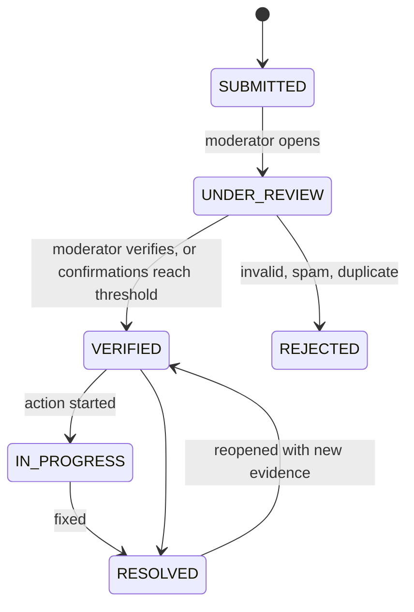

> **Source:** docs/source/BLUEPRINT.md, SECTION 2, lines 88-317 (verbatim, generated by `pnpm spec:split`; do not edit). **Precedence:** Appendix: source of truth for features, flows, roles, validation, tables, endpoints and security unless Part A (visuals) or Part B (backend/infra) changes them (Part 0.3).

## SECTION 2: COMPLETE FEATURE BREAKDOWN

### 2A. SAFEROUTE: Community Safety Reporting

**Purpose:** Crowdsource unsafe locations and infrastructure problems and track them to resolution.

**Features**
| Feature | Tag |
|---|---|
| Submit report (category, location pin, description, 1–4 photos) | MVP |
| Categories: Broken streetlight, Poor lighting, Pothole, Damaged road, Damaged footpath, Isolated/unsafe area, Other | MVP |
| Browse list and map view of reports with filters (category, status, distance, date) | MVP |
| Report detail page with status timeline | MVP |
| Community verification ("I confirm this" once per user per report) | MVP |
| Moderator status changes with note | MVP |
| Duplicate-nearby warning on submit | MVP |
| My reports page | MVP |
| Flag inappropriate report | MVP |
| Anonymous display (author hidden from public, visible to moderators) | OPT |
| Comments on reports | OPT |
| Severity rating, heatmap view | FUTURE |
| Export or share to municipal authority | FUTURE |

**User actions:** create, edit (while Submitted only), delete own (while Submitted only), confirm others' reports, flag, filter, search, view map.

**User journey:** Open SafeRoute → tap "Report an issue" → pick category → drop pin or search address → add description and photos → review → submit → see it in "My reports" as *Submitted* → receive notifications as status changes → see *Resolved*.

**Fields**
| Field | Type | Rule |
|---|---|---|
| category | enum | required |
| title | text | 5–80 chars, required |
| description | text | 10–1000 chars, required |
| latitude, longitude | decimal | required, valid range, within service region (configurable bounding box) |
| address_text | text | auto-filled from reverse geocode, editable, max 200 |
| photos | image files | 0–4, JPEG/PNG/WebP, ≤5 MB each (compressed client-side to ≤1600 px) |

**Status management**

- Only moderators and admins change status. A mandatory note is required for REJECTED.
- The community-confirmation threshold (default 3 distinct users) moves SUBMITTED to a "Community-confirmed" badge and nudges review priority. It does not auto-verify.
- Every change is logged in `report_status_history`.

**Validation:** as the table above, plus max 5 reports per user per day (see rate limits), and the pin must fall inside the service region.

**Error and empty states:** no reports in the area ("Be the first to report an issue nearby"); photo too large or wrong type; map failed to load (fall back to list view); location permission denied (manual search); offline (retain draft in local storage).

**Permissions and security:** guests can view public reports (photos visible, author hidden); registered users create, confirm and flag; moderators change status. Photos are re-encoded server-side with EXIF stripped (location metadata removed); exact author identity is never shown publicly.

**Dependencies:** Notifications (status changes), Admin/Moderation (queue), Auth, and Dashboard (counts). The same location picker and map component is reused by AutoMate, JourneyGuard and SafeAlert.

---

### 2B. AUTOMATE: Shared Transportation

**Purpose:** Let people travelling the same way split an auto fare.

**Features**
| Feature | Tag |
|---|---|
| Create ride (source, destination, date/time, seats, estimated total fare, note) | MVP |
| Browse and search rides (origin, destination, date, seats) | MVP |
| Request to join (with optional message) | MVP |
| Creator accepts or rejects requests | MVP |
| Participant list, remaining seats, per-person fare share | MVP |
| Cancel request (participant) / cancel ride (creator) with notifications | MVP |
| Leave ride after acceptance | MVP |
| Manage "Created" and "Joined" rides, ride history | MVP |
| Contact reveal: phone visible between creator and accepted participants only | MVP |
| Ride chat (per-ride, accepted members only, Socket.io) | OPT |
| Women-only ride flag | OPT |
| Rating or reporting co-riders after the ride (reporting is MVP; ratings are OPT) | OPT |
| Route-overlap matching, recurring rides | FUTURE |
| In-app payments | FUTURE |

**User actions:** create, edit (before any request is accepted), cancel, search, request, withdraw, accept, reject, leave, start ride, complete ride, report user.

**User journey (creator):** Create ride → ride is *Open* → receives request notifications → accepts → seats decrease → *Full* when seats = 0 → on departure marks *In Progress* → after the ride marks *Completed*.
**User journey (rider):** Search → open ride detail → "Request to join" → await decision → *Accepted* → see creator's phone and co-riders → ride → ride completes.

**Fields**
| Field | Rule |
|---|---|
| source, destination | text plus lat/lng via the location picker; must differ by more than 300 m |
| departure_at | must be at least 15 min in the future and at most 14 days ahead |
| seats_total | integer 1–3 (passenger seats excluding creator; auto-rickshaws typically carry 3) |
| estimated_total_fare | integer ₹10–₹5000 |
| note | optional, ≤300 chars |
| women_only | boolean [OPT] |

**Per-person share** is displayed as `estimated_total_fare ÷ (accepted_participants + 1)` and updates live. It is labelled "estimate".

**Ride statuses:** Open, Full, In Progress, Completed, Cancelled.
- OPEN ↔ FULL is automatic, driven by seat count.
- OPEN or FULL → IN_PROGRESS manually by the creator, or automatically 15 min after departure_at if at least one participant is accepted.
- IN_PROGRESS → COMPLETED manually, or automatically 3 h after departure_at by a background job.
- Any pre-IN_PROGRESS status → CANCELLED by the creator, who must provide a reason; riders are notified.

**Request statuses:** Pending, Accepted, Rejected, Cancelled (by rider), Expired.

**Validation and business rules:**
- A user cannot request their own ride.
- One active request per user per ride (unique constraint).
- A user cannot join two rides departing within 1 hour of each other (prevents spam and double booking).
- Accepting a request must be atomic and fail if seats = 0 (database transaction with row lock).
- Max 3 open rides created per user at a time.
- Requests auto-expire when the ride starts or is cancelled.

**Error and empty states:** no rides match ("Create one, others will find it"); ride full (disable request button, show "Full"); request already pending; ride cancelled while viewing; accept fails due to a concurrent seat-taking (show friendly message and refresh).

**Permissions and security:** guests can browse limited ride cards (no names or phones) but must log in to request. Phone numbers are shown only to the creator and accepted participants. Participant identities are shown to the creator and accepted participants only. Ride safety tips are shown on the request screen.

**Dependencies:** Auth and profiles (name, photo, phone), Notifications (requests and decisions), Moderation (user reports), JourneyGuard (one-tap "Start journey for this ride" prefill).

---

### 2C. JOURNEYGUARD: Personal Journey Safety

**Purpose:** Give users a lightweight record and reminder system so a trusted person knows about a journey.

**Honest scope:** JourneyGuard stores trip details and notifies by email and in-app. It does **not** track live location, contact police, or guarantee escalation.

**Features**
| Feature | Tag |
|---|---|
| Start journey (destination, expected arrival, optional start point, notes, emergency contact) | MVP |
| Manage saved emergency contacts (up to 5) | MVP |
| Email the trusted contact when a journey starts, with a read-only status link | MVP |
| Active journey screen with countdown and "I've arrived safely" button | MVP |
| Extend ETA (up to 2 times, 30 min max each) | MVP |
| Overdue detection (background job) plus in-app and email reminder to user | MVP |
| Overdue email to trusted contact after the escalation window | MVP |
| Emergency button: opens phone dialer (`tel:`) for 112 and the saved contact | MVP |
| Journey history | MVP |
| Prefill from an AutoMate ride | OPT |
| Trusted-contact "I've reached out / acknowledge" button on the status link | OPT |
| Periodic check-in prompts | OPT |
| Live location sharing, SMS, WhatsApp, police integration | FUTURE |

**Overdue logic (decision):**

| Time | Event |
|---|---|
| ETA | Nothing visible, journey still ACTIVE |
| ETA + 10 min | Status → OVERDUE; in-app notification plus email to user: "Have you arrived?" |
| ETA + 30 min (default, user-configurable 20–60) | If still OVERDUE, email to trusted contact with journey details; mark `contact_notified_at` |
| Any time | User taps "I'm safe" → COMPLETED, and contact gets an all-clear email if they'd been alerted |

**Fields**
| Field | Rule |
|---|---|
| destination | required, text plus optional pin |
| start_point | optional |
| expected_arrival_at | required, between 5 min and 24 h in the future |
| emergency_contact_id | required, from saved contacts or created inline |
| notes | optional, ≤300 chars (e.g. vehicle number) |

**Emergency contact fields:** name (required), relationship (optional), email (required in MVP, since it is the only delivery channel), phone (optional, used for the call button), consent confirmation checkbox ("I have informed this person").

**Statuses:** Active, Overdue, Completed, Cancelled.

**Validation:** only 1 active journey at a time per user (simplicity). Contact email must be valid and not the user's own email. Max 3 journeys started per hour.

**Error and empty states:** no saved contacts (prompt to add one first); email delivery failure (show warning "We couldn't email Sam, call them directly"); no history yet; user's network is offline (explain that reminders are server-sent, so the journey is still tracked).

**Permissions and security:** journeys are visible only to the owner. The trusted contact page `/track/[token]` is read-only, shows only destination, ETA and status, and uses a 32-byte random token that expires 24 h after ETA. It shows no profile, phone or history. The contact can opt out ("Stop receiving emails from SaferStreets") via a link.

**Dependencies:** Notifications and email service, background scheduler, Auth, and the Profile emergency contact manager.

---

### 2D. SAFEALERT: Community Emergency Alerts

**Purpose:** Let users flag urgent incidents so opted-in nearby community members are informed.

**Honest scope:** SafeAlert is an informational community feature. It is **not** a dispatch system. Every alert screen shows the emergency call buttons prominently ("If someone is in danger, call 112 first").

**Features**
| Feature | Tag |
|---|---|
| Submit alert (category, location, description, optional photo) | MVP |
| Categories: Road accident, Medical emergency, Harassment, Fire, Public hazard, Other | MVP |
| Alert list and map (active alerts nearby, recent) | MVP |
| Alert detail with status and timeline | MVP |
| Emergency action bar (call 112, call local police/ambulance numbers) | MVP |
| Opt-in alert preferences: area (centre plus radius 1–10 km) and categories | MVP |
| Notify opted-in users in radius via in-app plus email | MVP |
| Community "Confirm" / "Not accurate" voting | MVP |
| Moderator verification, resolve, dismiss | MVP |
| Reporter can mark own alert as Resolved | MVP |
| Web push notifications (PWA) | FUTURE |
| SMS notifications | FUTURE |
| Auto-expiry of stale alerts | MVP (6 h default) |

**User journey:** Open SafeAlert → big "Report emergency" button → (banner: call 112 if in danger) → choose category → location (current location or pin) → short description → optional photo → submit → alert appears as *Active (Unverified)* → opted-in users in radius notified → moderators verify or dismiss → reporter or moderator marks *Resolved* → alert auto-expires.

**Fields**
| Field | Rule |
|---|---|
| category | required enum |
| description | 10–500 chars |
| latitude, longitude, address_text | required |
| photo | optional, 1 image ≤5 MB |
| is_anonymous_to_public | boolean, default true (author shown only to moderators) |

**Statuses:** Active (Unverified), Verified, Resolved, Dismissed, Expired, Removed (moderation).

**Validation and abuse rules:** account must be at least 24 h old with a verified email; max 3 alerts per hour and 10 per day; duplicate suppression (same category within 200 m and 30 min gets a "similar alert exists, confirm it instead?" prompt); a user with 3 dismissed alerts is suspended from SafeAlert pending admin review.

**Notification rule (decision):** an alert from an eligible account notifies matching opted-in users immediately, labelled "Unverified". Alerts from newer or flagged accounts wait in the moderator queue first. The notification text always includes the disclaimer and the 112 button.

**Error and empty states:** no active alerts nearby ("All quiet around you"); location unavailable; rate limit reached; notification delivery failure (logged, the alert still stays visible in-app).

**Permissions and security:** guests see category and approximate area only (coordinates rounded to ~500 m), with no description details or photos. Registered users see exact location and details. Opted-in users' locations are not stored as live positions, only a saved area centre they chose.

**Dependencies:** Notification service, Moderation, Auth, Location picker, and Preferences (opt-in).

---

