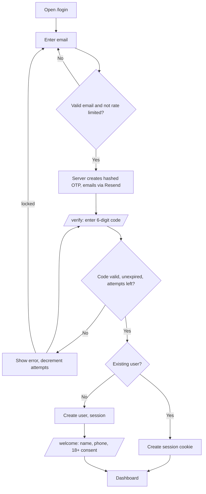
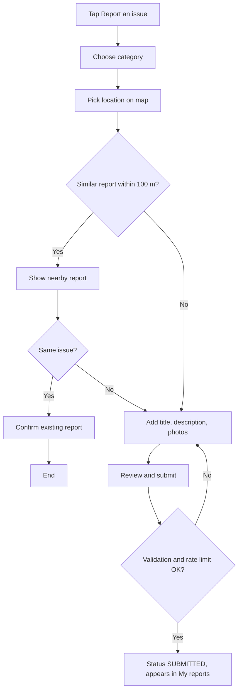
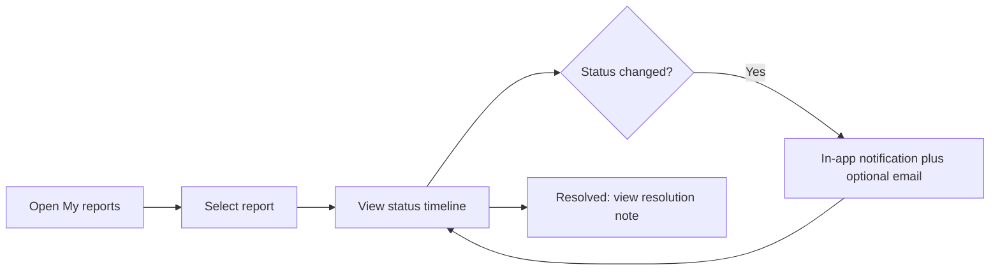
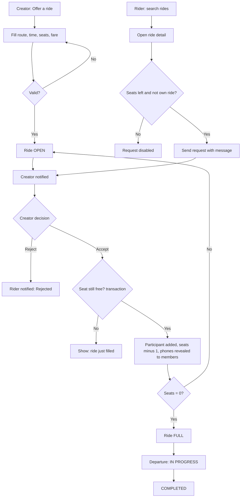
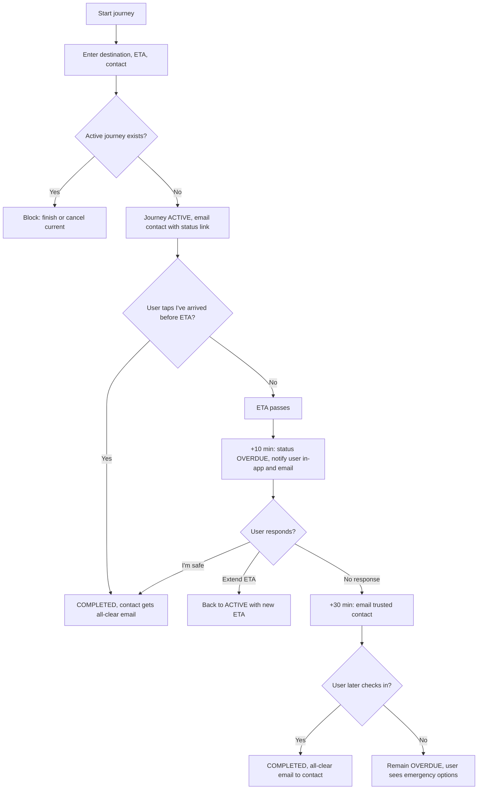
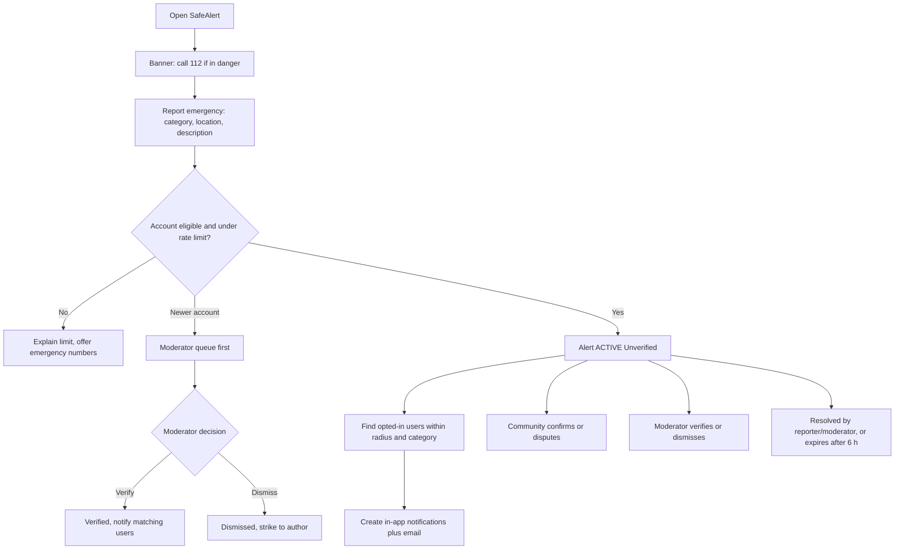
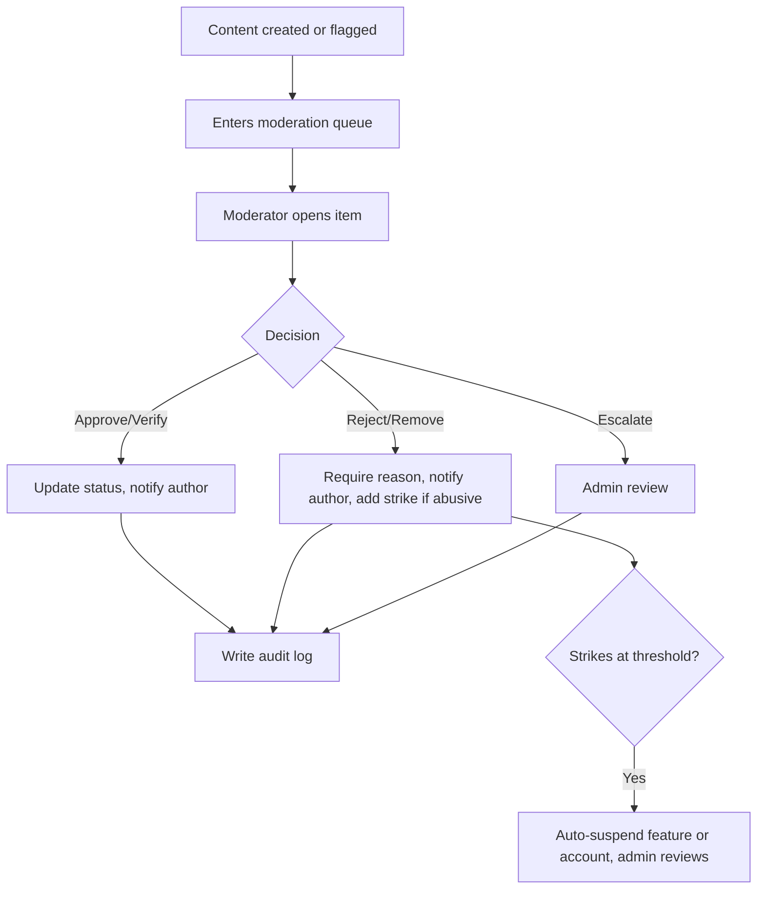

> **Source:** docs/source/BLUEPRINT.md, SECTION 5, lines 555-682 (verbatim, generated by `pnpm spec:split`; do not edit). **Precedence:** Appendix: source of truth for features, flows, roles, validation, tables, endpoints and security unless Part A (visuals) or Part B (backend/infra) changes them (Part 0.3).

## SECTION 5: USER FLOWS

### 5.1 Registration and Login

### 5.2 Submitting a SafeRoute Report

### 5.3 Viewing and Tracking a Report

### 5.4 Creating a Shared Ride and 5.5 Requesting/Accepting

### 5.6 Starting and Completing a Journey; 5.7 Overdue Handling

Nothing beyond email and in-app notification happens automatically (stated in the UI).

### 5.8 Creating and Viewing an Emergency Alert

### 5.9 Admin Moderation

---

