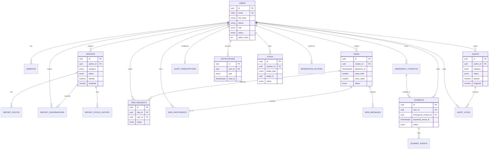

> **Source:** docs/source/BLUEPRINT.md, SECTION 6, lines 683-866 (verbatim, generated by `pnpm spec:split`; do not edit). **Precedence:** Appendix: source of truth for features, flows, roles, validation, tables, endpoints and security unless Part A (visuals) or Part B (backend/infra) changes them (Part 0.3). Part B4 adds tables and columns.

## SECTION 6: DATABASE DESIGN

**Database:** PostgreSQL. **Conventions:** UUID primary keys (`gen_random_uuid()`), `created_at` / `updated_at` as `timestamptz`, soft delete via `deleted_at` where noted, and enums implemented as Prisma enums.

### 6.1 Enums
| Enum | Values |
|---|---|
| UserRole | USER, MODERATOR, ADMIN |
| UserStatus | ACTIVE, SUSPENDED, BANNED, DELETED |
| ReportCategory | BROKEN_STREETLIGHT, POOR_LIGHTING, POTHOLE, DAMAGED_ROAD, DAMAGED_FOOTPATH, ISOLATED_AREA, OTHER |
| ReportStatus | SUBMITTED, UNDER_REVIEW, VERIFIED, IN_PROGRESS, RESOLVED, REJECTED |
| RideStatus | OPEN, FULL, IN_PROGRESS, COMPLETED, CANCELLED |
| RideRequestStatus | PENDING, ACCEPTED, REJECTED, CANCELLED, EXPIRED |
| JourneyStatus | ACTIVE, OVERDUE, COMPLETED, CANCELLED |
| AlertCategory | ROAD_ACCIDENT, MEDICAL, HARASSMENT, FIRE, PUBLIC_HAZARD, OTHER |
| AlertStatus | ACTIVE, VERIFIED, RESOLVED, DISMISSED, EXPIRED, REMOVED |
| NotificationType | REPORT_STATUS, REPORT_CONFIRMED, RIDE_REQUEST, RIDE_DECISION, RIDE_UPDATE, RIDE_MESSAGE, JOURNEY_REMINDER, JOURNEY_OVERDUE, ALERT_NEARBY, ALERT_UPDATE, MODERATION, SYSTEM |
| FlagTargetType | REPORT, RIDE, ALERT, USER, RIDE_MESSAGE |
| FlagStatus | OPEN, ACTIONED, DISMISSED |

### 6.2 Tables

**users**
| Column | Type | Constraints |
|---|---|---|
| id | uuid | PK |
| email | citext | UNIQUE, NOT NULL |
| email_verified_at | timestamptz | |
| full_name | varchar(60) | NOT NULL after onboarding |
| phone | varchar(15) | nullable, format-checked |
| avatar_url | text | |
| role | UserRole | default USER |
| status | UserStatus | default ACTIVE |
| terms_accepted_at | timestamptz | |
| strike_count | int | default 0, CHECK ≥ 0 |
| alerts_suspended_until | timestamptz | |
| prefs | jsonb | notification and privacy preferences |
| last_login_at, created_at, updated_at, deleted_at | timestamptz | |

**otp_codes**: `id`, `email`, `code_hash` (HMAC-SHA256 with server secret), `expires_at`, `attempts` (int), `consumed_at`, `ip`, `created_at`. Index `(email, created_at desc)`.

**sessions**: `id`, `user_id` FK, `token_hash` UNIQUE, `user_agent`, `ip`, `expires_at`, `revoked_at`, `created_at`. Index `user_id`.

**emergency_contacts**: `id`, `user_id` FK (cascade), `name`, `relationship`, `email`, `phone`, `consent_confirmed` bool NOT NULL, `unsubscribed_at`, timestamps. UNIQUE `(user_id, email)`; max 5 per user enforced in the service layer.

**reports**: `id`, `author_id` FK, `category`, `title` varchar(80), `description` text, `latitude` numeric(9,6), `longitude` numeric(9,6), `address_text`, `status`, `confirmation_count` int default 0, `moderator_note`, `resolved_at`, timestamps, `deleted_at`. CHECKs on lat/lng ranges. Indexes: `(status, created_at desc)`, `(category)`, `(latitude, longitude)`, `author_id`.

**report_photos**: `id`, `report_id` FK, `url`, `storage_key`, `width`, `height`, `position`. **report_confirmations**: `report_id`, `user_id`, `created_at`, PK `(report_id, user_id)`. **report_status_history**: `id`, `report_id`, `from_status`, `to_status`, `changed_by` FK, `note`, `created_at`.

**rides**: `id`, `creator_id` FK, `source_text`, `source_lat`, `source_lng`, `dest_text`, `dest_lat`, `dest_lng`, `departure_at` timestamptz, `seats_total` smallint CHECK 1–3, `seats_taken` smallint default 0 CHECK `seats_taken <= seats_total`, `estimated_total_fare` int CHECK 10–5000, `note`, `women_only` bool [OPT], `status`, `cancel_reason`, timestamps. Indexes: `(status, departure_at)`, `(source_lat, source_lng)`, `(dest_lat, dest_lng)`, `creator_id`.

**ride_requests**: `id`, `ride_id` FK, `user_id` FK, `message`, `status`, `decided_at`, timestamps. **UNIQUE `(ride_id, user_id)`**; index `(user_id, status)`.

**ride_participants**: `ride_id`, `user_id`, `joined_at`, `left_at`; PK `(ride_id, user_id)`. The creator is not a participant row (the creator is `rides.creator_id`).

**ride_messages [OPT]**: `id`, `ride_id`, `sender_id`, `body` (≤500), `created_at`. Index `(ride_id, created_at)`.

**journeys**: `id`, `user_id` FK, `emergency_contact_id` FK, `destination_text`, `dest_lat`, `dest_lng`, `start_text`, `notes`, `started_at`, `expected_arrival_at`, `extensions_used` smallint default 0, `status`, `overdue_at`, `contact_notified_at`, `completed_at`, `track_token_hash` UNIQUE, `track_token_expires_at`, `escalation_minutes` default 30. Partial UNIQUE index on `(user_id) WHERE status IN ('ACTIVE','OVERDUE')` enforces one active journey. Index `(status, expected_arrival_at)` for the scheduler.

**journey_events**: `id`, `journey_id`, `type` (STARTED, EXTENDED, REMINDER_SENT, CONTACT_NOTIFIED, COMPLETED, CANCELLED), `meta` jsonb, `created_at`.

**alerts**: `id`, `author_id` FK, `category`, `description`, `latitude`, `longitude`, `address_text`, `photo_url`, `status`, `is_anonymous` bool, `confirm_count`, `dispute_count`, `needs_review_first` bool, `verified_by` FK, `resolved_at`, `expires_at`, timestamps. Indexes: `(status, created_at desc)`, `(latitude, longitude)`, `author_id`.

**alert_votes**: `alert_id`, `user_id`, `vote` ('CONFIRM'|'DISPUTE'), PK `(alert_id, user_id)`.

**alert_subscriptions** (opt-in): `user_id` PK/FK, `enabled`, `center_lat`, `center_lng`, `radius_km` CHECK 1–10, `categories` AlertCategory[], `email_enabled`.

**notifications**: `id`, `user_id` FK, `type`, `title`, `body`, `link`, `data` jsonb, `read_at`, `email_sent_at`, `created_at`. Index `(user_id, read_at, created_at desc)`.

**flags**: `id`, `reporter_id` FK, `target_type`, `target_id` uuid, `reason` (enum or text ≤300), `status`, `resolved_by`, `resolution_note`, `created_at`. UNIQUE `(reporter_id, target_type, target_id)`; index `(status, created_at)`.

**moderation_actions** (audit log): `id`, `actor_id` FK, `action` (VERIFY, REJECT, REMOVE, SUSPEND, BAN, ROLE_CHANGE, STRIKE, etc.), `target_type`, `target_id`, `reason`, `meta` jsonb, `created_at`. Append-only (no update/delete in the application).

**system_settings**: `key` PK, `value` jsonb, `updated_by`, `updated_at` (region box, thresholds, emergency numbers).

### 6.3 ER Diagram

*(`flags.target_id` is polymorphic, so it has no database-level FK; integrity is enforced in the service layer.)*

### 6.4 Data Validation
Validation happens at three layers: Zod schemas shared by the web and API (primary), the service layer for business rules, and database CHECK / UNIQUE / FK constraints as the final safety net. Geographic queries use a bounding-box prefilter on lat/lng indexes, then Haversine distance in SQL or in code. PostGIS is [FUTURE], to be adopted if scale demands it.

### 6.5 Retention and Privacy
| Data | Retention |
|---|---|
| OTP codes | Deleted 24 h after expiry |
| Sessions | Deleted 30 days after expiry/revocation |
| Journeys and events | Keep 90 days after completion, then delete (user can delete sooner) |
| Emergency contacts | Until the user deletes them; hard-delete on account deletion |
| Ride messages | 30 days after ride end |
| Alerts | Keep 12 months for moderation analytics, with the author link dropped after 90 days |
| Reports | Retained (public-interest data); author link anonymised on account deletion |
| Notifications | 60 days |
| Audit log | 2 years |
| Account deletion | Soft delete → 30-day grace → PII scrub (email, name, phone, photo); public content retains anonymised authorship |
- Phone numbers are stored only if provided, are never returned by public endpoints, and are never logged.
- Provide a "Download my data" export (JSON) [OPT] and account deletion [MVP].

---

